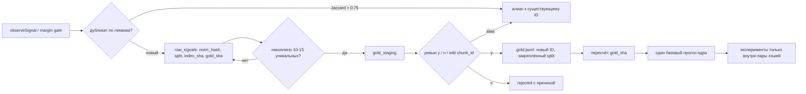
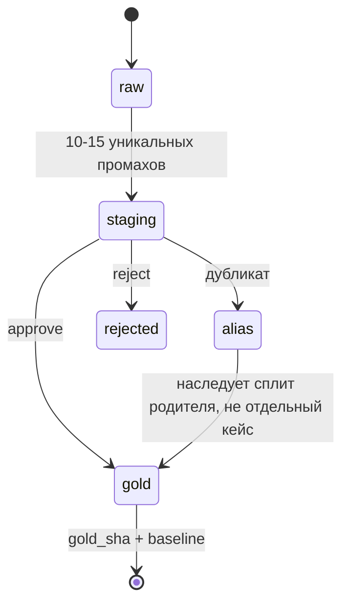
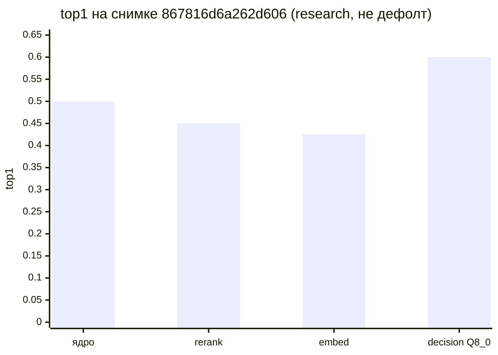

# Рост золотого корпуса на реальных промахах

Дата: 22.11. Статус: **дизайн согласован, реализация — следующий шаг**.

Этот документ фиксирует, как gold-корпус растёт за счёт реальных промахов,
не превращаясь в помойку и не устраивая data leakage между train и held-out.
Решение принято после того, как мы дважды ловили дрейф метрик из-за
перетасовки сплитов и self-referential `index_sha`.

---

## Почему понадобилось отдельное правило

Сейчас `memory/gold.jsonl` — это 40 запросов, сплит считается на лету как
`sha256(query)[0] % 5 === 0` (held-out = 9). Такая схема хороша, пока корпус
заморожен, но ломается при росте:

1. Перетасовка при каждом добавлении может перетащить пример, на котором
   подкручивали пороги, из train в held-out — валидация становится враньём.
2. Переформулировки одного вопроса раздувают корпус и создают видимость
   независимых кейсов там, где по смыслу один кейс.
3. Сырой сигнал из бота напрямую в gold даёт возможность одному мисклику
   отравить эталон.
4. Недельная работа над одним модулем перекашивает held-out в одну тему.
5. При смене `gold_sha` прежние протоколы сравнимы только внутри старой пары
   снимков — без явной пары хэшей границы сравнения размываются.

---

## Зафиксированные решения (до написания кода)

| # | Правило | Как ложится на наш стек | Чего не делаем |
|---|---|---|---|
| 1 | Сплит навсегда | `split`, `split_policy`, `hash_salt` пишутся **в строку gold**; 40 старых кейсов backfill'им без пересчёта | Не пересчитываем сплит при чтении и не меняем соль молча |
| 2 | Дедуп по смыслу | Jaccard по леммам (`memory-lemma.js`) против gold **и** `raw_signals`; >0.75 → алиас к ID в его сплите | Не считаем Jaccard судьёй: синонимы и разные намерения он не ловит |
| 3 | Карантин | `raw_signals` → `gold_staging` → ручное `y/n/edit` → `gold.jsonl` | Не льём сырой сигнал прямо в эталон |
| 4 | Стратификация | Квота ≤30% на `expect_source` за батч, переполнение в очередь, учёт по train и held-out раздельно | Не выбрасываем кейсы сверх квоты, не перекашиваем только train |
| 5 | Пара хэшей | `index_sha` (документы) + `gold_sha` (эталон) в каждом протоколе; новый базовый прогон ядра при смене пары | Не сравниваем гипотезы из разных пар |

### Важная оговорка про первые 40 кейсов

Переход на новую формулу `sha256(salt + norm) % 100` **не применяется**
к существующим записям: мы уже тюнеровали пороги на их train-части, и часть из 9
held-out могла бы уехать в train — это ровно та утечка, которую мы
предотвращаем. Старые сплиты закрепляются, новая формула работает только
для новых ID. Версия соли хранится рядом со сплитом.

---

## Контур: от сигнала до замерa

### Состояния кандидата

---

## Таблица сплитов

| Кого | Откуда сплит | Можно ли менять |
|---|---|---|
| 40 существующих ID | закреплённое поле `split` | **Нет**, backfill один раз |
| Новые ID | `bucket = parseInt(sha256(salt + norm).slice(0,8),16) % 100`; `<75` → train, иначе held-out | Только вместе с новой версией `hash_salt` и полным rebaseline |
| Алиасы | сплит родительского ID | Не меняется, не считается за новый кейс |

Нормализация перед хэшем: `query.trim().toLowerCase().replace(/\s+/g, ' ')`.

---

## Что сохраняется в `raw_signals`

| Поле | Зачем | Источник |
|---|---|---|
| `query`, `norm_hash` | стабильная идентичность запроса | ввод пользователя |
| `suggested_split`, `hash_salt` | сплит без обращения к остальной базе | детерминированный хэш |
| `candidate_chunk_ids` | что предложило ядро | `recallDocs()` |
| `expected_chunk_id` | правильный ответ, если выведен надёжно; иначе `null` | выбор пользователя / ревью |
| `index_sha`, `gold_sha` | снимок на момент события | протоколы |
| `origin` | `miss` или `control` | триггер |
| `ts`, `ttl` | карантин и автоудаление | рантайм |

Триггеры первого цикла: явный `memory_signal` и промах по margin/confidence
гейту. Событие «переформулировал за 30 сек» в APK пока не существует —
добавим отдельно, а не будем выдумывать телеметрию.

`raw_signals` живут только в app-private `filesDir` под hash-замком, с лимитом
и TTL. В GitHub уходит **только** отобранный gold с ID источников.

---

## Дедуп: матрица решений

| Jaccard по леммам | Смысл | Действие |
|---|---|---|
| > 0.75 | совпадает | алиас к существующему ID, сплит родителя |
| > 0.75 | различается (например, «найти» vs «удалить») | новый кейс с меткой `near-duplicate` на ревью |
| ≤ 0.75 | совпадает (синоним без общих токенов) | кандидат, ревью решает |
| ≤ 0.75 | различается | новый кейс |

Проверка идёт против всех gold-вопросов **и** против буфера `raw_signals`,
чтобы буфер не раздувался переформулировками.

---

## Квоты и стратификация

| Ось | Лимит | Что делаем с переполнением |
|---|---|---|
| `expect_source` | ≤30% новых кейсов на батч | очередь `pending` с приоритетом и счётчиком `quota_skipped` |
| `split` | квота считается отдельно для train и held-out | не даём перекосу в одну часть |
| `origin` | держим контрольную выборку `control` рядом с `miss` | иначе corpus станет только сборником тяжёлых случаев |

---

## Пара хэшей и baseline

| Хэш | Что фиксирует | Где живёт |
|---|---|---|
| `index_sha` | проиндексированные документы | `tools/llama-bench/*.json` |
| `gold_sha` | сам gold-корпус | тот же протокол |
| `baseline` | один прогон ядра после смены пары | `baselines.json`, ключ — пара хэшей |

Правило: сравнение двух гипотез допустимо **только** внутри одной пары
`(index_sha, gold_sha)`. После вливания новой пачки gold сразу делается один
базовый прогон ядра и фиксируется новая точка отсчёта.

---

## Текущий research-снимок (для наглядности)

Значения ниже относятся к снимку `867816d6a262d606` и нужны только чтобы
показать профиль моделей. Актуальные числа — в
`tools/llama-bench/*bench*.json`, потому что они привязаны к хэшу; правка
этого документа сама сдвигает `index_sha`.

| Участник | top1 | top3 | held-out top1 | Вердикт |
|---|---|---|---|---|
| Детерминированное ядро | 0.500 | 0.850 | 5/9 | эталон, дефолт |
| rerank | 0.450 | 0.875 | 6/9 | выигрыш top3, проигрыш top1 |
| embed | 0.425 | 0.875 | 5/9 | без устойчивого выигрыша |
| decision Q8_0 | 0.600 | 0.850 | — | сильнее, но ~3.7 с/запрос |
| гибрид RRF | train 0.516 vs 0.484 | 0.839 | 5/9 = ядро | выигрыш на train не подтверждён |

---

## Что делаем дальше

1. `gold-corpus.mjs`: backfill сплитов, `gold_sha`, чтение/запись gold.
2. `signal_candidates` в адаптивном store: hash-замок, лимит, TTL.
3. `curate-gold.mjs`: дедуп, подсказка сплита, квота, `y/n/edit`, append,
   пересчёт `gold_sha`, вызов `run-core-tests.sh`.
4. `gold_sha` в четырёх протоколах + `baselines.json`.
5. Никакого перетюнинга гибрида до 100+ кейсов и 25+ независимых held-out.
   `DEFAULT_MODE="legacy"` и data-plane/code-plane разделение не трогаем.
