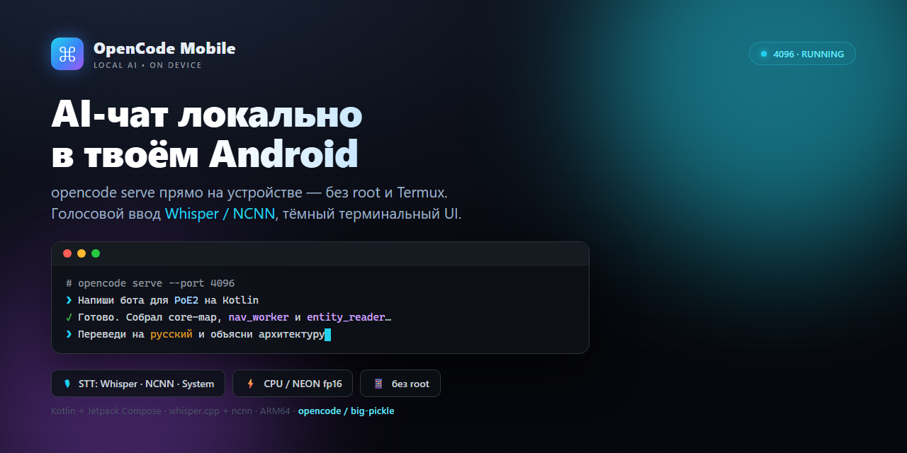

# OpenCode Mobile

<p align="center">
  
</p>

Android-приложение, которое запускает **opencode serve** прямо на устройстве
(без Termux, без root) и даёт полноценный чат с AI-моделью в нативном интерфейсе.

`Kotlin` · `Jetpack Compose` · `WebView` · `whisper.cpp`+Vulkan (STT) · `musl`

---

## Что это

Обычно opencode работает на десктопе (CLI/TUI) или на сервере. Это приложение
упаковывает сам бинарь opencode внутрь APK и поднимает локальный HTTP-сервер
прямо на телефоне/планшете. Поверх сервера — два слоя UI:

1. **WebView** с веб-интерфейсом opencode (тот же, что в браузере).
2. **Нативный чат-оверлей** поверх WebView — так как официальная SPA не
   рендерит ленту сообщений в окружении WebView, чат реализован нативно:
   приложение опрашивает локальный API opencode адаптивно (400 мс при активной
   генерации, 900 мс в покое) и рисует переписку сам (Compose).

Итого: «всё в один тап» — открыл приложение, написал сообщение, получил ответ
от модели, которая считается локально на устройстве.

> Это экспериментальный / демонстрационный проект (MVP). Подробности по
> параметрам сборки и известным ограничениям — в конце.

---

## Версия opencode

Приложение работает на **opencode 2.0.27** — все семь этапов перехода с 1.x
закрыты и лежат в [docs/MIGRATION-V2.md](./docs/MIGRATION-V2.md). Что это
знает и что перестало работать:

| Что было в 1.x | Как в 2.x |
|---|---|
| Пути без префикса: `/session`, `/session/{id}/message` | Всё под `/api/`: `/api/session/…` |
| Тело промпта `{"parts":[{"type":"text","text":"…"}]}` | `{"text":"…"}` (+ необязательный `delivery`) |
| `POST /session/{id}/abort` | `POST /api/session/{id}/interrupt` |
| `GET /session/status` — карта занятости | Эндпоинта **нет**. Статус синтезируется из ленты: последнее сообщение `type:"idle"` |
| Ответ — голый массив | Ответ обёрнут в `{"data":[…]}`; сообщения приходят **новыми → старыми** |
| Вопросы и разрешения разбирались из текста | Родной `GET /api/session/{id}/permission` + ответ `{"decision":"once"\|"always"\|"reject"}` (сервер отвечает 204) |

Слой, который это прячет от остального кода, — `server/ApiShape.kt` (приводит
ответ 2.x к виду 1.x) и `server/ApiStatus.kt` (замена удалённого `/session/status`).
Потребители не делятся по версии: форма ответа определяется сама, по конверту.

> **Не спрашивайте у этого приложения версию по документации — спрашивайте у
> живого сервера.** `GET /global/health` на 2.x отвечает `200` с HTML-заглушкой
> SPA на любой неизвестный путь, поэтому по коду ответа его не определить.
> Единственный источник истины — `GET /api/info`:
> ```powershell
> . .\tools\adb-auth-common.ps1
> (Invoke-WebRequest "http://127.0.0.1:4098/api/info" -Headers (Get-OpencodeAuthHeader)).Content
> # {"version":"2.0.27","pid":9064,"urls":["http://127.0.0.1:4096"],…}
> ```
> Расхождение версии сервера и бинаря в APK само пишется в лог тегом
> `ServerFlavor`.

---

## Возможности

### Чат
- Полноценная переписка с моделью в нативном интерфейсе (Compose).
- Поле ввода, оптимистичная отправка, автопрокрутка (с умной остановкой,
  когда пользователь сам листает историю вверх).
- Индикатор «думает» (анимированные полоски) пока модель размышляет.
- Вибрация при завершении ответа.
- **Карточка вопроса**: если модель спрашивает выбор/уточнение — приложение
  показывает варианты и поле для своего ответа. Один вызов может содержать
  **несколько** вопросов — рисуются отдельными блоками. Не «разбор текста»,
  а родной `GET /api/session/{id}/permission` с `action:"question"`; текст
  вопроса берётся из ленты по `permission.source.id` (в самом запросе его нет).
- **Карточка разрешения**: если модель зовёт команду, которая требует согласия
  (`action:"shell"` и вообще любой запрос из `/permission`), карточка встаёт
  над полем ввода. Ответ — `{"decision":"once"}`, сервер отвечает 204, и
  только после этого команда выполняется.
- **Видно, почему отказало.** Ошибка провайдера показывается в ленте строкой
  «⚠ …» с кодом и статусом, а не молчанием. Отдельно от текста: озвучка это
  не читает, и в счётчик отвеченных не попадает.
- **Озвучка ответов** — по выбору: системный голос Android, локальная модель
  Supertonic (оффлайн) или облако ElevenLabs. Если выбранный движок не
  готов, приложение **прямо пишет причину** («API-ключ не задан — читает
  системный голос») оранжевой строкой под настройкой, а молча переключается
  на запасной.
- На пустой переписке — анимированный дождь (рисуется кодом, не картинкой).

### Мобильный агент (moltbook)
- Отдельный тик (`MoltbookTicker`) поднимает агента по расписанию
  (`MoltbookWake`/`AlarmReceiver`/`WatchdogReceiver`) и засыпает обратно.
- Подтверждение комментария с повторами: платформа отвечает «ok», но
  перечитка ещё не видит комментарий — поэтому проверка идёт и по новым, и по
  лучшим комментариям, несколько попыток, иначе запись считается
  неподтверждённой, а не успешной.

### Локальная память (MCP)
- Вместе с serve поднимается второй процесс — **memory.js**: MCP-сервер
  локальной памяти (`127.0.0.1:4199/mcp`, streamable HTTP), хранилище в
  `$XDG_CONFIG_HOME/opencode/memory/`. Модель получает memory-инструменты
  (запоминать/искать по прошлым сессиям).
- Индикатор **«N MCP»** в шапке чата — сколько MCP-серверов зарегистрировано
  в serve (запрос `GET /api/mcp`). Если конфиг потерялся — `ensureMcpConfig()`
  сам допишет секцию `mcp.memory` в `opencode.jsonc` до старта serve
  (фикс «0 MCP»). Проверка в диагностике — протокольная: `GET /api/mcp` → 2xx
  (не просто TCP-порт).

### Голосовой ввод (STT) — два движка
1. **Системный Android (Google)** — встроенный распознаватель, не требует
   загрузки моделей, нужен доступ к сети.
2. **Whisper.cpp (GGML Vulkan)** — офлайн, уходит на GPU телефона
   (`GGML_VULKAN=ON` + `flash_attn`), 8 потоков. Движок и модель скачиваются
   отдельно: движок 86 МБ в `files/engines/whisper/`, модель 465 МБ в
   `filesDir/models/`. Кнопки — в **Настройки → Диагностика**.

**Модель одна: `small`.** Все её замеры, сравнение с turbo/medium/base/tiny и
разбор того, почему ncnn выпилен, — в [docs/VOICE-REPORT.md](./docs/VOICE-REPORT.md).
Коротко: WER 11,3 % за 2,0–2,2 с на GPU (против 4,7–4,9 с на CPU при том же
качестве). Нескачанная модель в пикере **не выбирается** — об этом прямо
написано в подписи строки.

Движок выбирается в настройках (шестерёнка в шапке чата).

**Потоковый пайплайн (ЭКСП-5)**: VAD-сегментация + чанкинг — длинная речь
режется на сегменты, каждый распознаётся отдельно (первые слова видны на
1–2 с, без потери хвоста на записи >30 с, меньше галлюцинаций).
Классы: `SpeechSegmenter`, `ChunkedTranscriber`. Подробности —
`docs/EXPERIMENTS-STT-LATENCY.md`.

**Сегментация и цена прохода.** Whisper всегда кодирует окно 30 секунд, поэтому
короткая фраза платит за тишину: у `small` проход занимает ~2 с **независимо**
от длины клипа. Из этого следует практическое правило — количество сегментов
умножается на цену одного прохода. Порог разрыва вынесен в `SpeechSegmenter.splitGapMs` (900 мс): раньше
`PAD_MS=450` служил и порогом разрыва, и padding'ом, из-за чего запись в
37 с резалась на 12 сегментов (145616 мс) вместо 9 (**60070 мс**, замер
27.09.2026). Девять сегментов на настоящей записи — корректное разбиение, а не
недорез: паузы в живой речи длиннее 900 мс. «Два сегмента» из регрессионного
теста — свойство синтетики с равномерными паузами 0.61 с. Клипы ≤28 с идут
одним прогоном без VAD — делить короткую речь дороже, чем распознать её целиком.

**Определение языка.** Язык больше не зашит как `ru` (из-за чего английская
речь переводилась на русский). Язык решается **один раз на запись** и
защёлкивается — граница сессии это одна запись
(`ChunkedTranscriber.transcribe()`), которая сбрасывает защёлку.
`encoder_states` при этом считается **один раз**: язык читается
дополнительным префиллом `[sot]` (+~40 мс), а не вторым прогоном encoder'а
(−6.5 с на каждый сегмент без защёлки). Fallback — `ru`. Порог по
уверенности намеренно не введён: референсный `whisper_lang_auto_detect`
тоже делает голый argmax, а неоткалиброванный порог ломает определение
языка сильнее, чем помогает. В logcat (`VOICE`) видно вероятность выбора.

Решение о языке принимает **первый проход движка, а не первый сегмент VAD**.
Детектор отказывается работать на кусках короче 3 с — на коротких он выбирает
язык по шуму, — поэтому `ChunkedTranscriber.planParts()` склеивает ведущие
короткие сегменты до порога и определяет язык уже на достаточном куске.
Раньше такой сегмент уходил в декодер с токеном `ru`, и запись начиналась с
русской расшифровки иностранной речи: на `long.wav` первые два сегмента из
девяти давали `И так, мои дорогие американцы` и `«Аск not!»`, остальные семь
были верными. Склейка бесплатна — VAD разрезал один непрерывный кусок, и
объединённый кусок от целого ничем не отличается; попутно девять проходов
движка стали восемью, `long.wav` ускорился с 64667 до **52458 мс**.
Проверено на устройстве 27.09.2026: `jfk.wav` (11 с) и `long.wav` (37 с) через
сервис определяются как `en` с латинским выводом, и на чанковом пути весь текст
с первого сегмента английский.

**Подавление повторов.** Декодер шёл жадно и на коротких клипах с
микропаузами любил выдать одну фразу трижды подряд. Перед `argmax`
применяется `apply_repetition_penalty()`: токен, закрывающий уже
встречавшуюся тройку, получает `-INF`, а выданный языковой токен мягко
штрафуется (делится на 1.15). Штраф делением, а не запретом — жёсткий
бан выкашивал бы легитимные повторы («да, именно»). Оговорка: на `long.wav`
тройное повторение приходит из самого материала (файл — это ~3 повтора
`jfk.wav`), так что этот фикст подавление повторов не проверяет; нужен
отдельный wav, где фраза звучит один раз.

> Статус: гейт зелёный (ktlint + detekt + unit-тесты).
> **Device-верификация 27.09.2026** (чанкинг, авто-язык), **13–14.10.2026** —
> движок и модель переведены на GPU (см. [docs/VOICE-REPORT.md](./docs/VOICE-REPORT.md)).

### Модель STT
- **small (465 МБ, f16)** — **единственная модель в приложении.** Скачивается
  по требованию из панели настроек (прогресс, докачка при разрыве, проверка
  целостности — SHA-256 + размер в sidecar `.size`).
- Каталог моделей живёт в одном месте — `stt/SttModels.kt`. base, medium, turbo
  и tiny вычеркнуты **с замерами и причинами** (см. KDoc каталога и отчёт):
  turbo даёт +3,7 п.п. WER за ×5 времени, medium — почти ту же точность за ×3
  времени, base ошибается в каждой трети слов, tiny хуже base.
- Из ncnn-движка не осталось ничего: его Vulkan-путь стабильно падает
  `SIGSEGV` на Adreno 840 (<https://github.com/Tencent/ncnn/issues/7097>).

### Настройки чата
- **Шрифт ответов модели** — 20+ встроенных шрифтов (тап по образцу — сразу
  применяется и сохраняется; кнопка — иконка шрифта).
- **Цвет ответов модели** — градиент-пикер (тап/драг по квадрату; кнопка —
  иконка-капля, тонируется текущим цветом ответов).
- **Диагностика STT** — «TTS-тест»: синтезирует фразу системным TTS и гонит её
  через выбранный движок распознавания. Позволяет понять — проблема в модели/пайплайне
  или в микрофоне (результат в logcat по тегу `VOICE`).

### Сервер
- Foreground-сервис держит процесс opencode serve, рестартует его с backoff
  при падении, проверяет доступность по HTTP.
- **Basic Auth**: serve доступен наружу (HTTP на `127.0.0.1:4096`), поэтому
  все запросы идут с заголовком Authorization; пароль генерируется при
  первом запуске и лежит в зашифрованных prefs (`ServerAuth`). Без пароля —
  `401 Unauthorized` (проверено на чистой установке).
- Рабочая директория (workspace, конфиг, сессии, память) — на внешнем
  хранилище `/sdcard/Documents/OpencodeTerminal/opencode/`, переживает
  переустановку приложения (в отличие от prefs/моделей).
- Уведомление с кнопкой «Stop» и статусом процесса.
- Диагностика (`RuntimeValidation`): порты serve/память, протокольная
  проверка MCP (`/api/mcp` → 2xx), наличие и валидность модели STT — экран
  «Диагностика» в настройках.
- Приложение само закрепляет в управляемом конфиге бесплатную модель
  (`opencode/big-pickle`) и ключ `"question": "ask"` в разделе `permission`.
  Без второго модель задаёт вопрос и **не создаёт** запрос на разрешение —
  инструмент висит в состоянии `running`, и карточке нечего показать.
  Пользовательский конфиг при этом не переписывается: если ключ или модель
  уже заданы, приложение их не трогает.

### Свои ключи провайдеров
В приложении **нет** зашитых API-ключей — ни одного, включая ключ ElevenLabs
для озвучки (хранится в `AndroidKeyStore`, в prefs лежит только шифротекст).
Ключи вводит
пользователь у себя на устройстве, в конфиг opencode:
`/sdcard/Documents/OpencodeTerminal/opencode/opencode-data/opencode/opencode.json`
(тот же формат, что на десктопе: секция `provider` с полем `apiKey`).

Пример для OpenCode-Go:
```json
{ "provider": { "opencode-go": { "options": { "apiKey": "sk-ТВОЙ_КЛЮЧ" } } } }
```

Пароль локального serve (Basic Auth) генерируется при первом запуске и лежит
в зашифрованных prefs — тоже не в репозитории.

---

## Техническое устройство (как это работает)

### Запуск opencode на Android без root

Android-ядро позволяет `execve` только с **PIE**-бинарём, и только из
`nativeLibraryDir` для `untrusted_app`. Поэтому:

| Файл (`app/src/main/jniLibs/arm64-v8a/`) | Роль |
|---|---|
| `libopencode.so` | Бинарь opencode **2.0.27** (musl-сборка arm64, 195.5 МБ, переименован в `lib*.so`) |
| `libldmusl.so` | musl-лоадер (это `ld-musl-aarch64.so.1`, он же libc) |
| `libstdcxx.so`, `libgcc_s.so` | **Alpine** GCC-рантайм под placeholder-именами (2.63 + 0.13 МБ) |
| `libc_musl.so` | musl libc под placeholder-именем |
| `libbun-musl.so` | musl-Bun — **JS-рантайм самого приложения** (`Retention.kt`, harness-скрипты), не opencode |

Ключевые моменты:

1. **`useLegacyPackaging = true`** в `app/build.gradle.kts` — заставляет
   `extractNativeLibs=true`. Без этого `.so` не извлекаются на диск (маппятся из
   APK для dlopen) и `execve` невозможен.
2. Бинарь — **динамический musl**: в нём `PT_INTERP=/lib/ld-musl-aarch64.so.1`,
   которого в системе нет. Поэтому лоадер запускается первым аргументом:
   `ld-musl ./libopencode.so serve --port 4096`.
3. **Имена `lib*.so`** — PackageManager извлекает только такие файлы; при старте
   зависимые либы копируются в `filesDir/musl` с правильными DT_NEEDED-именами,
   на них указывает `LD_LIBRARY_PATH`.
4. **Бинарь 2.x не статический.** Ему нужен GCC-рантайм именно Alpine
   v3.22 (`libstdc++.so.6.0.33`, `libgcc_s.so.1`) — поэтому в APK лежат они.
   Системные `libc++.so`/`libgcc_s.so` Android'а **не подходят**: они сами
   линкуются против bionic, и на устройстве это даёт
   `Error loading shared library libstdc++.so.6`, а с подменой на системные —
   нехватку `__register_atfork`, `_Unwind_*`, `__system_property_get`.
   Официальный установщик opencode 2.x этих библиотек не везёт: он рассчитан
   на хост Alpine.

### Локальная память MCP и Basic Auth

| Процесс | Порт | Роль |
|---|---|---|
| `libopencode.so serve` | `127.0.0.1:4096` | сам сервер opencode (HTTP API, Basic Auth) |
| `libbun-musl.so memory.js` | `127.0.0.1:4199` | MCP-сервер локальной памяти (streamable HTTP/SSE) |

- Модель видит память, только если serve **зарегистрировал** MCP-сервер.
  Регистрация — секция `"mcp": { "memory": { "type": "remote", "url": ... } }`
  в `$XDG_CONFIG_HOME/opencode/opencode.jsonc` (тот же формат, что на
  десктопе: `~/.config/opencode/opencode.json`). `OpencodeRuntime.ensureMcpConfig()`
  дописывает её идемпотентно (атомарно tmp+rename) до старта serve — фикс
  «0 MCP» (пустой конфиг, когда память слушала порт, но не была зарегистрирована).
- Индикатор «N MCP» в шапке чата = ответ `GET /api/mcp` с сервера (через
  `LocalOpenCodeClient` с авторизацией; без заголовков serve отвечает 401).
- Память хранится в `$XDG_CONFIG_HOME/opencode/memory/` (json-каталог прошлых
  сессий), переживает переустановку приложения.

### STT: foreground-сервис и GPU

На ColorOS/OPPO фоновые compute-потоки душатся до 1–5% CPU. Поэтому
распознавание выполняется в **foreground-сервисе** (`WhisperTranscribeService`) —
так ОС даёт процессу нормальный приоритет. Модель кэшируется в памяти между
вызовами (грузится один раз).

Сам whisper считает на **GPU** телефона: `GGML_VULKAN=ON`, `flash_attn=true`,
8 потоков. Модель `small` (465 МБ) на OnePlus CPH2747 / Adreno 840:

| бэкенд | проход | rtf | WER (7 клипов) |
|---|---|---|---|
| **GPU** | **~2 с** | 0,20–0,37 | **11,3 %** |
| CPU | ~4,8 с | 0,46–0,86 | 11,3 % |

Качественно GPU и CPU дают **одинаковый** результат, разница только в
скорости (×2,2). Полные таблицы по всем моделям и разбор выбора —
[docs/VOICE-REPORT.md](./docs/VOICE-REPORT.md).

Запись: `AudioRecord` → PCM16 16кГц → нормализация пика (телефоны пишут тихо) →
подкладка тишины (whisper врёт на очень коротких клипах) → распознавание →
текст в поле ввода.

---

## Сборка

### Требования
- **Android Studio** (или Android SDK + JDK 17) с SDK Platform 36.
- ARM64-устройство (физический телефон) или arm64-эмулятор.
- Файл `local.properties` с путём к SDK (или переменная `ANDROID_HOME`) —
  не коммитится в git, в клоне его нет.
- Достаточно PowerShell 7 (`pwsh`) и сети: нативы тянутся из npm, Alpine и
  GitHub-релизов.

> ⚠️ **Собирать с `-SkipNative`, если нет whisper.cpp и VulkanSDK.** Нативка
> whisper собирается из исходников и требует внешних зависимостей, которых в
> репозитории нет; без флага сборка упадёт на конфигурации CMake. Подробности
> в «Про бинари» ниже.

### Шаги
0. **Скачать нативы** (в git их нет, см. «Про бинари» ниже):
   ```powershell
   pwsh -File tools\fetch-opencode-binary.ps1
   ```
   Без этого шага сборка пройдёт, а APK будет без сервера.
1. Открыть папку проекта в Android Studio, дождаться синка Gradle.
2. Собрать: `Build → Build APK(s)` или из терминала:
   ```bash
   ./gradlew :app:assembleDebug -PskipNativeBuild=true
   ```
   На Windows есть обёртка `build.ps1` (Android Studio JDK, offline, лог
   в `build-inst.log`):
   ```powershell
   pwsh -File build.ps1 -Task debug -SkipNative
   ```
3. APK появится в `app/build/outputs/apk/debug/opencode-debug-<дата>-<git-sha>[-dirty].apk` — в имени метка времени и хэш коммита, иначе установленные сборки не отличить друг от друга. Старые сборки не перезаписываются, поэтому имя берётся последним по времени:
   ```powershell
   Get-ChildItem app/build/outputs/apk/debug/*.apk | Sort-Object LastWriteTime -Desc | Select-Object -First 1
   ```
4. Установить:
   ```powershell
   adb install -r (Get-ChildItem app/build/outputs/apk/debug/opencode-debug-*.apk | Sort-Object LastWriteTime -Desc | Select-Object -First 1).FullName
   ```
   или просто скопировать APK на телефон и открыть.

### Про бинари (важно)

- `app/src/main/jniLibs/arm64-v8a/` — **в git НЕ лежит** (`.gitignore`), туда
  кладутся все нативы: `libopencode.so`, `libldmusl.so`, `libc_musl.so`,
  `libstdcxx.so`, `libgcc_s.so`, `libbun-musl.so`, `libsherpa-onnx-jni.so`,
  `libonnxruntime.so`. Из свежего клона рабочее
  приложение не соберётся, а **сборка при этом не упадёт**: Gradle просто не
  найдёт файла и соберёт APK без сервера — приложение стартует, opencode не
  запускается, и причина неочевидна.
- Поэтому **весь комплект** нативов ставится одной командой:
  ```powershell
  pwsh -File tools\fetch-opencode-binary.ps1           # скачать и положить
  pwsh -File tools\fetch-opencode-binary.ps1 -Check    # только проверить
  pwsh -File tools\fetch-opencode-binary.ps1 -Force    # скачать заново
  pwsh -File tools\fetch-opencode-binary.ps1 -SkipTts  # без sherpa/onnxruntime (46 МБ)
  .\build.ps1 -Task binary                             # то же через build.ps1
  ```
  Скрипт тянет все восемь файлов из четырёх публичных источников, каждый
  сверяет по размеру **и sha256** (размер у разных сборок совпадает, поэтому
  проверяется именно хеш), а в конце прогоняет ту же проверку, что и `-Check`.
  Источники:

  | файл | откуда |
  |---|---|
  | `libopencode.so` | npm `@opencode/cli-linux-arm64-musl` — **релизов на GitHub для 2.x не существует вообще**, официальный установщик бинарь не качает |
  | `libbun-musl.so` | npm `@oven/bun-linux-aarch64-musl` (не библиотека, а сам bun: ELF типа `ET_EXEC`) |
  | `libc_musl.so`, `libldmusl.so` | Alpine v3.21 musl — `ld-musl-aarch64.so.1` под двумя именами, побайтово один файл |
  | `libstdcxx.so`, `libgcc_s.so` | Alpine v3.21 GCC-рантайм (бинарь opencode **не статический**) |
  | `libonnxruntime.so` | GitHub-релиз sherpa-onnx 1.13.8, сборка `android-aarch64-termux-shared` |
  | `libsherpa-onnx-jni.so` | тот же релиз, но `sherpa-onnx-static-link-onnxruntime-1.13.8.aar` — **не** из `.tar.bz2`, там лежит другая сборка на 4.7 МБ |

  `-Check` дополнительно ищет в `libopencode.so` маркеры musl
  (`libstdc++.so.6`, `libgcc_s.so.1`), чтобы не принять windows-сборку или 1.x
  за 2.x. Рядом скрипт пишет `natives.json` — что откуда и с каким хешем.
- `debug` и `release` **проверяют комплектность и хеши нативов перед сборкой**
  и падают со списком того, чего не хватает или что не сходится. Обойти —
  `-SkipBinary`. Если офлайн-речь не нужна — `-SkipTts`: он убирает 46 МБ и
  проверку этих двух файлов тоже (иначе отказ от речи пришлось бы отменять
  `-SkipBinary`).
- Версия бинаря opencode живёт в `gradle.properties`, строкой `opencode.binaryVersion`.
  Это единственный источник правды: его читают скрипт загрузки, `app/build.gradle.kts`
  (`BuildConfig.OPENCODE_VERSION`, его показывает экран «О программе») и `build.ps1`.
  Смена версии = смена этой строки + прогон скрипта. Версии остальных нативов
  (bun 1.4.0, sherpa-onnx 1.13.8, Alpine v3.21) закреплены пинами прямо в скрипте.
- **whisper-нативка (`whisperlib`) из репозитория НЕ собирается.** Нужны
  внешние зависимости, которых в git нет: **whisper.cpp** (путь по умолчанию
  жёстко зашит как `C:/Projects/whisper.cpp`, менять через
  `-PwhisperCppDir=...`) и **VulkanSDK** от LunarG (`-PvulkanSdkDir=...`) плюс
  Visual Studio с «Desktop development with C++». Сборка сверяет коммит
  whisper.cpp с пинном из `whisperlib/src/main/jni/whisper/WHISPER_PIN` и
  падает при расхождении.
  ⇒ **Из свежего клона собирайте с `-SkipNative`** (то же делает CI — на
  ubuntu нет ни whisper.cpp, ни VulkanSDK). Распознавание речи при этом
  отключается, всё остальное работает.
  Проверено: `git clone` + скрипт нативов + `build.ps1 -Task debug -SkipNative`
  даёт рабочий APK, сервер отвечает, агент отвечает.
- Модель STT (`ggml-small.bin`) в assets **не хранится** — качается по требованию
  через `ModelDownloader` в `filesDir/models/`. Движок whisper.cpp (86 МБ) тоже
  качается отдельно, в `filesDir/engines/whisper/` — оба набора берутся из
  GitHub-релиза движков и проверяются по размеру и SHA-256.

---

## Установка готового APK

Установка:

> ⚠️ Два пакета сосуществуют: **release** (`org.opencode.mobile`, «OpenCode Mobile») и
> **debug** (`org.opencode.mobile.debug`, «OpenCode Mobile · Debug»). Отличаются по названию
> под значком.

- **Debug** («OpenCode Mobile · Debug»):
  ```powershell
  adb install -r (Get-ChildItem app/build/outputs/apk/debug/opencode-debug-*.apk | Sort-Object LastWriteTime -Desc | Select-Object -First 1).FullName
  adb shell monkey -p org.opencode.mobile.debug -c android.intent.category.LAUNCHER 1
  ```
- **Release** («OpenCode Mobile», R8-минифицирован, подписан release-ключом):
  ```bash
  # Один раз: создать ключ и заполнить шаблон (сам файл — секрет, в .gitignore).
  keytool -genkeypair -v -keystore ~/keys/opencode-release.jks -storetype PKCS12 \
          -keyalg RSA -keysize 4096 -validity 10000 -alias opencode-release
  cp keystore.properties.example keystore.properties   # вписать путь и пароли

  gradlew.bat :app:assembleRelease -x lint
  adb install -r (Get-ChildItem app/build/outputs/apk/release/opencode-release-*.apk | Sort-Object LastWriteTime -Desc | Select-Object -First 1).FullName
  adb shell monkey -p org.opencode.mobile -c android.intent.category.LAUNCHER 1
  ```

  **Ключ и пароли никогда не коммитятся.** `keystore.properties` и `*.jks`/`*.keystore`
  в `.gitignore`. Потерянный ключ = невозможность выпустить обновление: Play потребует
  нового приложения с другим `applicationId`. Держи бэкап ключа отдельно от репозитория.

  Если `keystore.properties` нет (например, на CI), release собирается с debug-подписью
  и печатает предупреждение `release-key НЕ НАЙДЕН ... публиковать её НЕЛЬЗЯ`. Такую
  сборку публиковать нельзя — она совместима только с уже установленным debug.
  Проверить, чем подписан APK:
  ```bash
  $ANDROID_HOME/build-tools/36.0.0/apksigner.bat verify --print-certs (Get-ChildItem app/build/outputs/apk/release/opencode-release-*.apk | Sort-Object LastWriteTime -Desc | Select-Object -First 1).FullName
  ```

### minVerify: проверить release-пайплайн на устройстве

Обычные device-тесты гоняют `debug`, где R8 выключен. Поэтому есть отдельный
build type `minVerify`: release с R8 и `shrinkResources`, но `debuggable` и с
суффиксом пакета — встаёт рядом с debug, ничего не ломая.

```bash
# обычный цикл разработки (быстро, без R8)
gradlew.bat connectedAndroidTest

# проверка того, что R8 не сломал STT
gradlew.bat -PsttTestBuildType=minVerify connectedMinVerifyAndroidTest
```

`testBuildType` переключается через `-P`, поэтому androidTest-вариант
существует только для одного build type за раз, и оба пути остаются
доступными.

Keep-правила — в `app/proguard-minverify-rules.pro`, на release они не
влияют. **Без них инструментация не запустится:** R8 оптимизирует по графу
вызовов приложения и не видит тестовый APK, поэтому выкидывает members,
которые вызывает только тест. Отсюда `-keep,allowoptimization` — имена нужны
для линковки теста, но оптимизация остаётся включённой, её мы и проверяем.

Перед выкладкой стоит убедиться, что JNI-класс уцелел при обфускации:
```bash
# Lcom/whispercpp/whisper/WhisperLib$Companion; должен ПРИСУТСТВОВАТЬ в classes.dex
```
Его спасает правило из дефолтного `proguard-android-optimize.txt`:
`-keepclasseswithmembernames,includedescriptorclasses class * { native <methods>; }`

Подробности — CHANGELOG, п. 18.

Логи смотреть:
```bash
adb logcat -s OpencodeRuntime OpencodeServerService OpencodeWebView VOICE RuntimeValidation ChatOverlay
```

> ⚠️ **После переустановки (uninstall → install)**: сессии/история/память на
> внешнем хранилище сохраняются, но **авторизация сбрасывается** — serve
> сгенерирует новый пароль, и движок с моделью STT нужно скачать заново
> (`filesDir` стирается). Проверка: «OpenCode server — Running», мониторинг
> чата работает с новым паролем автоматически.

---

## Структура проекта

```
app/
  src/main/
    java/org/opencode/mobile/
      MainActivity.kt            # точка входа, WebView, статус сервера
      OpencodeApp.kt             # глобальный конфиг каталогов (sandbox + $XDG_CONFIG_HOME)
      server/
        OpencodeServerService.kt # foreground-сервис: жизненный цикл serve
        OpencodeRuntime.kt       # запуск musl-лоадером + ensureMcpConfig (память MCP)
        RuntimeManager.kt        # стейт-машина запуска: память → serve → HEALTHY (backoff)
        RuntimeState.kt          # состояния рантайма
        RuntimeValidation.kt     # диагностика: порты, memoryHttpOk() (протокол MCP), модели
        ProcessSupervisor.kt     # рестарты с backoff + контроль процессов
        Workspace.kt             # пути к workspace/конфигу (external storage)
        ServerAuth.kt            # Basic Auth: генерация пароля, заголовки, Keystore/prefs
        LocalOpenCodeClient.kt   # единый HTTP-клиент serve (get/post/postAsync/delete + auth)
        ApiPaths.kt              # пути API opencode 2.x (/api/…)
        ApiShape.kt              # ответ 2.x → вид 1.x: конверт {data}, порядок, части
        ApiStatus.kt             # занятость сессии (в 2.x /session/status удалён)
        ApiMcp.kt                # три формы ответа /api/mcp → плоский список
        ApiAsk.kt                # запросы разрешений и вопросов + ответ на них
        AskBlocks.kt             # разбор questions[] из вызова question
        ServerFlavorProbe.kt     # сверка версии сервера с версией в APK (в лог)
        PermissionPlan.kt        # дописать "question":"ask" в управляемый конфиг
        Jsonc.kt, JsonBody.kt    # разбор jsonc-конфига и «это вообще JSON?»
        V1Leftovers.kt           # вычистить мёртвые node_modules 1.x из конфига
        Retention.kt             # JS-рантайм приложения (musl-Bun) + harness
        Ipv4Proxy.kt             # исходящая сеть (CONNECT-туннель, IPv4-first)
      stt/
        WhisperTranscribeService.kt  # foreground-сервис распознавания
        SpeechSegmenter.kt           # VAD-сегментация речи (ЭКСП-5)
        ChunkedTranscriber.kt        # чанкинг: сегменты → отдельные распознавания
        SttModels.kt                 # каталог моделей (сейчас одна — small) + замеры
        ModelDownloader.kt           # скачивание ggml-small (lazy, resume, integrity SHA-256)
        SttBenchReceiver.kt          # отладочный вход: WAV → та же очередь (для бенчей)
        SttWav.kt                    # разбор RIFF/WAVE
      engine/
        EngineCatalog.kt             # состав и размеры скачиваемых движков
        EngineStore.kt               # скачивание движка (resume, SHA-256, chmod +x)
        EngineLibs.kt                # System.load в порядке зависимостей
      installer/
        AppInstallBridge.kt          # loopback RPC для MCP: /v1/apps, /v1/media, /v1/account
        AppInstallWire.kt            # провод моста: тело запроса, коды ошибок, ответ на запуск
        ApkInstaller.kt              # скачивание/проверка APK → системный PackageInstaller
        InstalledAppController.kt    # PackageManager: список и запуск launcher-приложений
      media/
        MediaControlController.kt    # MediaSession: status/control/like без запуска activity
        MediaWire.kt                 # формы медиа-ответов моста (verified живёт внутри media)
      ui/
        ChatOverlay.kt           # нативный чат поверх WebView + настройки
        chat/
          ChatApi.kt             # снимок чата: /message + /mcp + плашка → ChatSnapshot
          SessionOps.kt          # сессии: создать, прервать, удалить, вычистить пустые
          PromptOps.kt           # промпт, очередь, ответ на запрос сервера (ask)
          ChatStallTracker.kt    # зависание хода, бюджет повторов, пауза поллинга
          ChatRows.kt            # строки ленты: thinking, live-tool, плашка, завис, отказ
          HeaderIndicators.kt    # шапка: статус/пинг, Zen-квота, контекст, MCP-список
          VoiceInput.kt          # запись WAV, распознавание речи, вибро, звук ответа
          MessageBubbles.kt      # реплика: заголовок роли, печать по буквам, TTS-выбор
        AskCardView.kt           # вёрстка карточки вопроса/разрешения
        SttModelPicker.kt        # выбор модели STT (нескачанная не выбирается)
        EmptyChatArt.kt          # дождь на пустом экране (рисуется кодом)
        DiagnosticsScreen.kt     # экран диагностики (порты/MCP/движки/модели)
        theme/Theme.kt
      tts/                      # озвучка: SpeechFactory, TtsNarrator, Supertonic/ElevenLabs
      social/                   # мобильный агент moltbook: тик, будильник, watchdog
    assets/                       # шрифты, MCP-ассеты (memory/moltbook/ynison), harness
    jniLibs/arm64-v8a/           # нативы НЕ в git: opencode + musl/Bun/GCC + sherpa (см. fetch-opencode-binary.ps1)
 whisperlib/                      # JNI-обёртки whisper.cpp
   src/main/jni/
     whisper/                     # whisper.cpp (ggml; use_gpu + flash_attn + квант-гейт)
     whisper/CMakeLists.txt       # переменные внешних путей: WHISPER_LIB_DIR
docs/
  MIGRATION-V2.md                # переход на opencode 2: что поменялось, что отменили
  ROADMAP.md                     # треки к релизу + статусы
  VOICE-REPORT.md                # голос: замеры всех моделей, выбор small, разбор краша ncnn
  ncnn-vulkan-crash-report.md    # баг-репорт в ncnn (Adreno 840, SIGSEGV)
  EXPERIMENTS-STT-LATENCY.md     # замеры STT-латентности, ЭКСП-5 (чанкинг)
  stt-bench-2026-09-24.csv       # бенч int8 vs fp32 (24.09.2026)
tools/
  fetch-opencode-binary.ps1      # скачать все 8 нативов (opencode, musl, Bun, GCC, sherpa) — в git их нет
  adb-auth-common.ps1            # пароль serve из /proc + готовый Basic-заголовок
  stt-accuracy.ps1               # бенч точности STT без участия человека (WER по эталону)
build.ps1                        # сборка на Windows: debug/release (Android Studio JDK)
```

---

## 🚀 Оптимизации и история изменений

Актуальные работы по производительности UI/рендера (подробно — [CHANGELOG.md](./CHANGELOG.md)):

| # | Что сделали | Результат |
|---|-------------|-----------|
| 1 | Инкрементный парсинг ленты + адаптивный поллинг (400/900 мс) | Парсинг ушёл (58 cached / 0 parsed) |
| 2 | Приостановка фонового WebView (SPA) | Frame-спайки: 99-перц. 21→9 мс, janky 6.87→0.33% |
| 3 | Убраны вечные анимации индикаторов | UI CPU 33→2%, RenderThread 10→0% |
| 4 | Пауза поллинга и анимаций, когда Activity в фоне | Фоновый CPU ~0% |
| 5 | Эффективное мигание MCP (дискретный пульс вместо 60fps) | Мигание возвращено, CPU ~8% (фон 0%) |
| 6 | Все UI-кнопки на готовых Material-иконках (extended) | Микрофон, отправка, stop, шестерёнка, шрифт, цвет — векторные, читаемые |
| 7 | R8-минификация + shrinkResources в release | APK 374 → 274 MB (R8), затем lazy-вынос base → **147 MB** (release-подпись; пакет чистый `org.opencode.mobile`) |
| 8 | base-модель вынесена из assets в lazy-скачивание | base/turbo качаются по требованию; APK больше не тащит 141MB whisper |
| 9 | whisper.cpp переведён на GPU (`GGML_VULKAN` + `flash_attn`), квант-гейт | base: rtf 0,38 → 0,06–0,12 на том же тексте |
| 10 | ncnn выпилен, движки и модель качаются отдельно, осталась одна модель `small` | APK −33 МБ, WER 11,3 % за 2 с |

**Итог:** UI CPU ~38% → ~1.5-8% (×5–25), рендер 99-перц. 9 мс, janky 0.33%,
фон ~0%. Единственный хвост — внутренний `opencode serve` (~35%, код движка, не наш).

> Размер APK в таблице — сентябрьские цифры релизной сборки. С тех пор в пакет
> приехал бинарь opencode **2.x** (195.5 МБ вместо 184.7), а локальная речь
> добавила sherpa-onnx + onnxruntime (44.2 МБ): debug-сборка сейчас ~237 МБ.
> Уменьшить можно только решением по продукту — выкинуть офлайн-речь,
> но это и STT, и TTS.

---

## 🗺 Дорожная карта

План по доведению клиента до «продукта для чужих телефонов» (release-контур,
сеть без ручного прокси, STT turbo на CPU) — см. [docs/ROADMAP.md](./docs/ROADMAP.md).

---

## Тонкости / известные ограничения (MVP)

- **DNS / исходящая сеть — решено встроенным прокси**: бинарь opencode (musl/bun)
  не резолвит IPv6->IPv4 fallback и не читает `/etc/resolv.conf` на Android.
  В приложении поднимается встроенный `Ipv4Proxy` (CONNECT-туннель на
  `127.0.0.1:3128`), который резолвит строго по IPv4 через системный стек Netd;
  `HTTPS_PROXY` ставится автоматически при запуске `serve`. Внешние сервисы
  (`mcp.context7.com`, `mcp.grep.app`, `registry.npmjs.org`, модели) работают
  без ручного прокси-конфига. См. `Ipv4Proxy.kt`.
- **Сабпроцессы opencode** (`rg`, `git`, языковые серверы) на устройстве
  отсутствуют — часть фич (`/find`, git-интеграция) не работает.
- **ForegroundServiceType `specialUse`**: сервера и STT используют `specialUse`
  (+ `PROPERTY_SPECIAL_USE_FGS_SUBTYPE`). Для side-loaded MVP допустимо; для
  публикации в Play требуется прохождение ревью этого типа.
- **SELinux**: маппинг либ из `filesDir` (`mmap PROT_EXEC`) может быть ограничен
  политикой `untrusted_app` — проверено на реальном OPPO, на других устройствах
  стоит делать smoke-тест.
- **Performance STT**: модель `small` на GPU — проход ~2 с на любой длине клипа
  (whisper всегда кодирует окно 30 с, поэтому короткая фраза платит за тишину).
  Полные замеры — [docs/VOICE-REPORT.md](./docs/VOICE-REPORT.md).
- **WER посчитан**: эталонные транскрипты взяты из набора
  `C:\Projects\MyFLOW\data\eval_wispr` (624 фразы), движок — `tools/stt-accuracy.ps1`.
  `small`: **11,3 % на 7 клипах**, **17,4 % на 40 фразах с человеческим эталоном**
  (и 3,1 % на фразах до 4 секунд). Оговорка: `their_edited` заполнен лишь у 88
  записей из 624, у остальных эталон — вывод чужого ASR, поэтому абсолютные
  проценты смещены неизвестно на сколько.
- **Квантованные модели на GPU не работают** (turbo q5_0 → мусор, rtf 47–58).
  В `jni.c` стоит квант-гейт по имени файла; отладочный обход — метка `quant_gpu`
  рядом с моделью.
- **Vulkan (GPU) у whisper.cpp — рабочий и включён по умолчанию**
  (`GGML_VULKAN=ON`). Квант-гейт — единственное, что держит его в порядке.

### Ограничения сервера opencode 2.0.27 (замерено на устройстве)

- **Вопрос не продолжает ход.** Ответ `{"decision":"once","message":"…"}` снимает
  запрос, но инструмент `question` остаётся в `status:"running"` навсегда, а
  сессия из-за этого выглядит занятой и новые промпты уходят в мёртвый ход.
  Рабочая последовательность, которую делает приложение: **отправить ответ
  сообщением с `delivery:"queue"` и закрыть запрос `{"decision":"reject"}`** —
  тогда ход возобновляется и модель отвечает.
- **Возможен зависший вызов без запроса.** Сервер иногда оставляет `question` в
  `running`, а `/permission` пуст — карточке показывать нечего. Помогает только
  новая сессия.
- **Нет `GET /api/session/{id}/view`** и **нет
  `/api/experimental/session/{id}/wait`** — оба 404. Сообщения остались на
  `/api/session/{id}/message`, статус заменён псевдо-сообщением `type:"idle"`.
- **Логи сервера получить нельзя.** Флаг `--standalone` объявлен в `--help`, но
  `serve` его не принимает (`Unrecognized flag`), а именно он включал логи.
  Разбираться приходится по logcat приложения.
- **Каталог моделей врёт.** `GET /api/model` отдаёт модель как
  `status=active enabled=true`, а инференс возвращает HTTP 410
  `ModelDeprecated`. Поэтому приложение закрепляет модель явно и показывает
  ошибку в ленте, а не молчит.
- **Неизвестный `GET` отвечает 200 с HTML-заглушкой SPA** — проверять живость
  и версию по коду ответа бесполезно, нужно смотреть тело.

---

## Лицензия и статус

Экспериментальный личный проект. API и внутренности могут меняться. Не является
официальным продуктом opencode.
