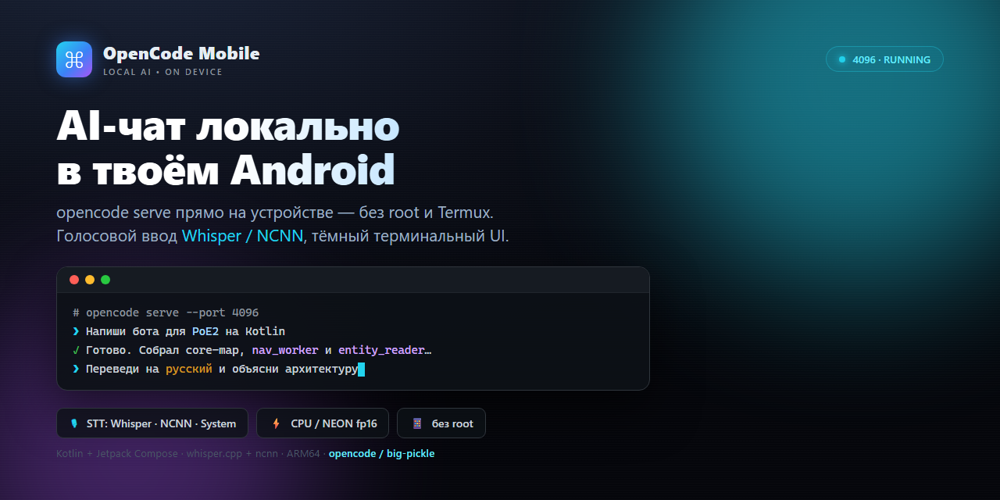

# OpenCode Mobile

<p align="center">
  
</p>

Android-приложение, которое запускает **opencode serve** прямо на устройстве
(без Termux, без root) и даёт полноценный чат с AI-моделью в нативном интерфейсе.

`Kotlin` · `Jetpack Compose` · `WebView` · `whisper.cpp`+Vulkan (STT) · `musl`

---

## Что это

Обычно opencode работает на десктопе (CLI/TUI) или на сервере. Это приложение
упаковывает сам бинарь opencode внутрь APK и поднимает локальный HTTP-сервер
прямо на телефоне/планшете. Поверх сервера — два слоя UI:

1. **WebView** с веб-интерфейсом opencode (тот же, что в браузере).
2. **Нативный чат-оверлей** поверх WebView — так как официальная SPA не
   рендерит ленту сообщений в окружении WebView, чат реализован нативно:
   приложение опрашивает локальный API opencode адаптивно (400 мс при активной
   генерации, 900 мс в покое) и рисует переписку сам (Compose).

Итого: «всё в один тап» — открыл приложение, написал сообщение, получил ответ
от модели, которая считается локально на устройстве.

> Это экспериментальный / демонстрационный проект (MVP). Подробности по
> параметрам сборки и известным ограничениям — в конце.

---

## Версия opencode

Приложение работает на **opencode 2.x**: в APK вшито ядро 2.3.0, но фактическая
версия может быть новее — ядро обновляется само, без пересборки APK (раздел
[«Обновление ядра»](#обновление-ядра-из-вшито-в-apk-в-качает-само) ниже). Все
семь этапов перехода с 1.x закрыты и лежат в
[docs/MIGRATION-V2.md](./docs/MIGRATION-V2.md). Что 2.x знает и что перестало
работать:

| Что было в 1.x | Как в 2.x |
|---|---|
| Пути без префикса: `/session`, `/session/{id}/message` | Всё под `/api/`: `/api/session/…` |
| Тело промпта `{"parts":[{"type":"text","text":"…"}]}` | `{"text":"…"}` (+ необязательный `delivery`) |
| `POST /session/{id}/abort` | `POST /api/session/{id}/interrupt` |
| `GET /session/status` — карта занятости | Эндпоинта **нет**. Статус синтезируется из ленты: последнее сообщение `type:"idle"` |
| Ответ — голый массив | Ответ обёрнут в `{"data":[…]}`; сообщения приходят **новыми → старыми** |
| Вопросы и разрешения разбирались из текста | Родной `GET /api/session/{id}/permission` + ответ `{"decision":"once"\|"always"\|"reject"}` (сервер отвечает 204) |

Слой, который это прячет от остального кода, — `server/ApiShape.kt` (приводит
ответ 2.x к виду 1.x) и `server/ApiStatus.kt` (замена удалённого `/session/status`).
Потребители не делятся по версии: форма ответа определяется сама, по конверту.

> **Не спрашивайте у этого приложения версию по документации — спрашивайте у
> живого сервера.** `GET /global/health` на 2.x отвечает `200` с HTML-заглушкой
> SPA на любой неизвестный путь, поэтому по коду ответа его не определить.
> Единственный источник истины — `GET /api/info`:
> ```powershell
> . .\tools\adb-auth-common.ps1
> (Invoke-WebRequest "http://127.0.0.1:4098/api/info" -Headers (Get-OpencodeAuthHeader)).Content
> # {"version":"2.0.27","pid":9064,"urls":["http://127.0.0.1:4096"],…}
> ```
> Расхождение версии сервера и бинаря в APK само пишется в лог тегом
> `ServerFlavor`.

---

## Обновление ядра: из «вшито в APK» в «качает само»

**От чего ушли.** Ядро opencode лежало только внутри APK. Обновить его значило
пересобрать APK: CI тянет 245 МБ тарбола, ~2,5 мин сборки, потом 253 МБ
установки. Дорого не только временем — после смены ключа подписи APK поверх
установленного **не встаёт вовсе** (Android не ставит обновление с другим
сертификатом), а каждая ошибка в ядре ждала следующей сборки, хотя чинится она
в двух строках `gradle.properties`.

**К чему пришли.** Приложение при старте само спрашивает официальный реестр npm
(`@opencode/cli-linux-arm64-musl`, тег `latest`), скачивает тарбол, сверяет
`dist.integrity` (sha512 — это подпись пакета, её даёт сам npm), прогоняет
кандидата `--version` и только потом кладёт его в
`filesDir/core/libopencode.so`, перезапуская `serve`. Ни пересборки, ни
установки, ни потери данных.

Почему это возможно без установки APK: ядро запускается не через `execve`, а
musl-лоадером из APK (`libldmusl.so <бинарь> serve …`), лоадер mmap-ит файл —
значит путь к бинарю может быть любым читаемым. Проверено 16.11: тот же лоадер
с бинарём на `/sdcard` отвечает `Not a valid dynamic program` (внешнее
хранилище смонтировано `noexec`), поэтому ядро живёт только во внутренней памяти
приложения.

| | было | стало |
|---|---|---|
| Источник ядра | `app/src/main/jniLibs` → внутрь APK | npm-пакет — **тот же**, что тянет CI |
| Как обновить | пересборка APK + установка 253 МБ | само при старте, в фоновом потоке |
| Чем проверено | CI: размер, sha256, маркеры musl | приложение: sha512 из реестра + `--version` |
| Цена ошибки | переустановка APK | откат на ядро из APK после двух падений подряд |
| Мажорные версии | вручную, новой сборкой | сознательно **не** автоматически |

**Что если новое ядро не поднимется.** `--version` доказывает только то, что
ELF грузится, — не то, что из него поднимается `serve`. Поэтому «ядро рабочее»
подтверждает не установка, а работа: `RuntimeManager` уже ждёт HTTP-ответ
сервера, и именно этот момент (`HEALTHY`) снимает счётчик неудач. Два падения
подряд на скачанном ядре — откат: файл удаляется, версия запоминается как
отбракованная (`core_blocked`), запуск возвращается к ядру из APK, а обновлятор
эту версию больше не ставит. Без этого шага плохое ядро оставляло приложение без
сервера навсегда: агент живёт внутри `serve`, и починить изнутри нечем.
Одного падения для приговора мало намеренно — первый старт бывает неудачным по
чужим причинам (занят порт, сеть, память), и откат по нему означал бы «никогда
не обновиться».

**Границы, за которые не идём:**

- 245 МБ по мобильной сети без спроса не качаются — обновление ждёт Wi-Fi.
- `3.x` на `2.x` само не накатится: приложение говорит с сервером по `v2` API,
  смена мажора — другой контракт, её решает человек.
- Проверка идёт не чаще раза в 6 часов и в отдельном потоке:
  `Application.onCreate` обязан возвращаться быстро, иначе ANR раньше, чем
  что-то покажется на экране.
- Пробный `--version` доказывает, что ELF грузится и musl-libs на месте; работу
  конкретных эндпоинтов он не проверяет — за это отвечает откат выше.
- Диагностика («Система → Ядро opencode») показывает **действующее** ядро, а не
  версию из APK, и умеет проверять обновление по кнопке — без ожидания
  шестичасового окна.
- Кнопка не угадывает причину: исход проверки — значение (`APPLIED`,
  `NOT_NEWER`, `BLOCKED`, `MAJOR`, `METERED`, `REGISTRY`, `DOWNLOAD`, `SMOKE`,
  `INSTALL`, `NO_DIR`), у каждого своя строка и в UI, и в логе. Раньше наружу
  отдавался `Boolean`, и экран отвечал одной фразой на три разных исхода
  («версия не новее, либо сеть тарифицируется, либо сверка не прошла»), а самый
  частый исход не писал в лог вообще ничего — проверить догадку было нечем.
- Итог последней проверки сохраняется вместе со временем и показывается строкой
  «Последняя проверка: 16.11 12:06 · в реестре 2.3.0, работает 2.3.0 —
  обновлять нечего». Без времени «не новее» читалось бы как «так и есть
  сейчас», хотя проверка могла быть вчерашней.

**Статус:** `apk-12` (ядро 2.3.0) стоит на телефоне с 16.11 и встал
**обновлением поверх** `apk-11` — данные и ключи целы (проверено по md5 против
снимка). Копия ядра в `filesDir` запускается лоадером из APK и отвечает
`opencode v2.3.0` (код 0), реестр npm с телефона отдаёт `200` и `latest 2.3.0`.
Полная авто-подмена ждёт версии новее 2.3.0 — до неё обновлятор молчит правильно.

**Откат проверен вживую, а не только тестами (16.11).** В `files/core` подложены
первые 1 МБ ядра (ELF-заголовок цел, остальное нет), в prefs — `core_version=9.9.9`,
`core_tries=0`; приложение перезапущено. Лог приложения:

```
11:58:20 W/CoreUpdater: ядро 9.9.9 не подняло сервер (1 из 2)
11:58:54 W/CoreUpdater: ядро 9.9.9 не поднимается 2 раза подряд — откатываюсь на 2.3.0
11:58:58 I/OpencodeServer: workspace=/storage/.../OpencodeTerminal external=true
```

То есть: два падения по 30 с (health-timeout), затем откат — файл удалён,
`core_blocked=9.9.9`, `core_rolled_back_at` записан, `core_version` снят, третий
старт пошёл с ядром из APK. Простой сервера — 70 секунд, вместился в
`MAX_RESTART_ATTEMPTS = 5`. Статус отката: **verified-live**.

---


## Документация

- [Возможности](./docs/features.md) — чат, мобильный агент, локальная память,
  самодиагностика, голосовой ввод, модель STT, настройки чата, сервер,
  свои ключи провайдеров.
- [Техническое устройство](./docs/architecture.md) — запуск opencode на Android
  без root, локальная память MCP и Basic Auth, STT и foreground-сервис.
- [Сборка и установка](./docs/build-and-install.md) — требования, сборка в GitHub
  Actions (основной путь), локальная альтернатива, бинари, установка готового
  APK и проверка release-пайплайна через minVerify.
- [Структура проекта](./docs/project-structure.md) — модули, исходники,
  opencode-пакеты и служебные каталоги.
- [История, дорожная карта и ограничения](./docs/history-and-limitations.md) —
  оптимизации, планы, известные тонкости и статус проекта.
