# OpenCode Mobile

<p align="center">
  
</p>

**Активная сборка: apk-80.** Установлена и принята вживую: `versionCode 80`,
ассет `dist-opencode-mobile-80-f621c06.apk`, 263 116 425 байт, sha256
`143076731a9d52ad34ad0768869ce8fb6ff98d922645a9c433f3e6ca7eba2ba9`, подпись
`196cdc94…` (та же, что у apk-59…79 — пользовательские данные сохраняются).
Release run #76 (`45442003832`) на коммите `f621c0676911` зелёный. Нижняя панель
переписана по референсам из `/sdcard/Documents/reference lowpanel`: текст,
спектр и микрофон/отправка — **один** тёмный контейнер, Stop снаружи. Спектр
появляется только при удержании голоса и рисуется на реальном PCM, а не на
случайных числах. Исправлены повторный старт записи и разрешение микрофона:
после выдачи доступа запись больше не идёт без удержания пальца. В APK зашит
**opencode 2.4.0** — бинарь внутри `lib/arm64-v8a/libopencode.so` байтно равен
npm `@opencode/cli-linux-arm64-musl@2.4.0`. Дефолт ядра — детерминированный
FTS5, внешние embed/rerank в APK не идут. В диагностике есть редактор
`AGENTS.md` (кнопки в «Ядре opencode» и Memory Core) и 16 сведений об устройстве
в секции «Система». После установки `verify-install.sh` → `match=yes`, MCP
`:4199` отдаёт **32 тула** с `wave4` в enum; последний зафиксированный живой
индекс — **23 источника / 902 чанка**, `index_sha 5440945b9becf9db` (замер после
apk-76). Число чанков и `index_sha` плавают по мере правок рабочих доков и
фиксируются в каждой записи замера.

**Полный тестовый раннер зелёный:** `345/0 + 38/0 + 39/0 + 140/0 + GGUF 109/0
+ замки 23/0`, CJK-guard чистый. Замороженный `gold_sha
b4421d088404551bd9506a83eb69e8c1be877a0b63a9169c6dd816d0803255f5` — 113
кейсов, 30 независимых held-out. Local recall@5 **0.9823**, MRR **0.8940**,
held-out recall@5 **1.000**. Дефолт ядра — `legacy`; `wave2`, `l0`, `wave4`,
`v4` и гибрид остаются opt-in research. Волна 4 (`mode:"wave4"`) доставлена в
apk-74: hard recall@5 **1.000**, h06 закрыт и в локальном, и в живом MCP.

**На архитектурном рубеже (ещё не в APK):** закрытое ядро для нового
пользователя. Принцип — APK несёт код ядра и стартовый gold, а не наш
operator-log. Память растёт из действий самого пользователя: `ingest` →
`signal` → курация → `approve`. Обсуждаемые правки под отдельное подтверждение:
`MCP_DOCS_DIR=""` в релизе, SQLite в app-private `filesDir`, версионированный
export/import-бандл с hash. apk-76 уже установлена; этот рубеж — по отдельному
слову Макса.

`Kotlin` · `Jetpack Compose` · `WebView` · `musl` · `FTS5` · `LLM` · `MCP` · `Bun`

---

## Что это

Обычно opencode работает на десктопе или сервере. Это приложение упаковывает
бинарь opencode в APK и поднимает локальный HTTP-сервер прямо на телефоне или
планшете — без Termux и без root. Поверх сервера два слоя интерфейса:

1. **WebView** с веб-интерфейсом opencode.
2. **Нативный чат-оверлей** на Compose: официальная SPA не рендерит ленту в
   WebView, поэтому приложение само опрашивает локальный API и рисует
   переписку (400 мс при генерации, 900 мс в покое).

Сверху над этим работает мобильный агент: он правит код, ходит в GitHub через
API, собирает APK в Actions, скачивает его, сверяет размер и sha256 и ставит на
телефон через системный диалог. PC-посредник убран 19.11 — всё делает сам
мобайл-агент на устройстве.

> Экспериментальный демонстрационный проект. Детали сборки —
> [docs/build-and-install.md](./docs/build-and-install.md), ограничения —
> [docs/history-and-limitations.md](./docs/history-and-limitations.md).

---

## От чего ушли и к чему пришли

| Было | Стало |
|---|---|
| PC-агент-посредник: телефон писал ему брифинги | Телефонный агент сам правит код, пушит, собирает и ставит APK |
| Ядро opencode только внутри APK, обновление = пересборка 253 МБ | Самообновление из npm с проверкой `dist.integrity` и откатом после двух падений |
| Простой FTS-поиск по памяти, дрейф контента | Детерминированное ядро: FTS5 + якоря, стабильный пул, аудит, откат, без молчаливого удаления |
| Память правилась сама собой | `memory_proposal`: дубли по `topic_key`, слияния по `sha`, конфликты `contradicts`; решение оператора через `ingest → approve` |
| LLM как «судья» чанков | LLM как переформулировщик и источник evidence; стандартный pack ядра всегда внутри |
| Плотные эмбеддинги «на всякий случай» | Rerank/embed/decision замерены, но в default не пущены: на held-out гибрид не лучше ядра |
| Сырой сигнал из бота сразу в gold | `raw_signals → gold_staging → y/n/edit → gold.jsonl`; сплит закреплён в строке, never recompute |
| Сплит считался на лету и мог утечь в held-out | `split_policy = "sha256-bucket-75-v1"`, алиасы наследуют сплит родителя |
| Сравнение метрик «просто по recall» | Только внутри пары `(index_sha, gold_sha)`; новая пара = новый baseline |
| Адаптивные веса в общем доступе | data-plane `memory-adaptive-store.js` под hash-замком, code-plane только через тесты и ручной апрув |
| Порядок источников индекса плавал | `collectSources()` сортирует по authority канонического источника и пути |
| Ручной ритуал выравнивания mtime перед переиндексацией | Корневой фикс: `created` неизменившихся чанков сохраняется по id |
| Красный полный CI: detekt, ktlint, JVM-тесты | Все слои починены кодом и baseline, без снижения порогов |
| `tmp/` около 1.03 ГБ и 238 записей | 25 нужных позиций и 15 МБ, архив и манифест в `MOBILE_AGENT/архивы/` |
| Разрозненные заметки | `СОСТОЯНИЕ.md` → `ПРАВИЛА.md` → `ЖУРНАЛ.md` → `ХАРНЕС.md`, длинные отчёты только в архивах |

---

## Самодиагностика без adb

Экран ошибки больше не говорит «Server failed. See logcat»: он показывает
`stage / code (recoverable) + message` и три последних сбоя. Этого хватает,
чтобы прочитать причину со скрина на телефоне друга.

Параллельно `FailureReporter` шлёт компактный отчёт в приватную группу
Telegram. Отправка живёт в `OpencodeServerService.onRuntimeState()` на стадиях
`CRASHED` / `FAILED_PERMANENTLY`, поэтому срабатывает даже если терминал не
открыт. В отчёте:

```
from: <имя из диагностики, по умолчанию USER>
reporter: <UUID установки>
role: DEV/ADMIN | USER
device: BRAND MODEL API ABI RAM
stage / code / message / history / time
```

Имя меняется в диагностике, секция «Отчёты о сбоях». Пути, логины и длинные
токены вырезаются; `opencode.log` не отправляется. Отчёт сначала ложится в
очередь `filesDir/failures/*.json` и досылается при появлении сети. Лимит —
один отчёт в час плюс дедуп 24 часа по `код|versionCode|gitSha`: crash loop не
заспамит группу. У каждого устройства свои префы и UUID, поэтому сбои с
других телефонов приходят независимо.

---

## Архитектура

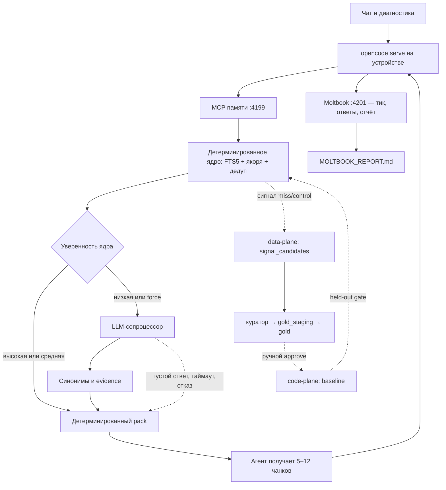

Ключевое правило: LLM **не пишет память** и не заменяет ядро. На вход ей
попадают только топ-N кандидатов после `memory_*`, а на выходе всегда лежит
обычный pack ядра. При любом невалидном ответе приложение молча возвращает
стандартный результат ядра.

Отдельная граница — **data-plane vs code-plane**. Сигналы и пороги живут в
`memory-adaptive-store.js` под hash-замком и не импортируются в `memory-core.js`.
Модель не имеет прямой записи ни в код, ни в рантайм: всё,
что меняет поведение ядра, проходит через тесты и human approve.

---

## Все этапы работы

| Сборка | Что сделано | Результат |
|---|---|---|
| **apk-12** | Самообновление ядра из npm | Рабочая версия 2.3.0, откат проверен вживую |
| **apk-31…40** | Правила Moltbook закреплены в коде, §5, дедуп отчёта | Живой плагин и эталон совпадают, отчёт уходит в `MOBILE_AGENT/` |
| **apk-41** | Детерминированное ядро памяти вшито в приложение | 10 инструментов, живой recall@5 0.90, adaptive 0.85, gate `pass` |
| **apk-44** | Загрузчик GGUF и модель `qwen3-0.6b-q4km` | Модель скачана отдельно, размер и sha256 сверены |
| **apk-45** | Резидентный LLM-сопроцессор | `memory_llm_status`, `memory_llm_search`, режимы `core-only` и `force` |
| **apk-46** | Жёсткий gold и монотонность `recallDocs` | pack и adaptive поднялись до 1.000, найден баг пула по `limit` |
| **apk-47** | Установка и честное перебазирование gate 0.90 → 0.85 | Живой recall 0.85, hard 1.000, долг g11/g17/g20 взят в работу |
| **apk-48** | Пул якорей расширен до 18 | Свежий gold 0.95, регресс-тест 4d |
| **apk-49** | Живой и свежий gold сведены | 1.000 / 1.000, h07 и p06 закрыты |
| **apk-50** | Техническая переходная сборка | Функционально равна apk-49 |
| **apk-51** | Полный CI починен кодом | detekt 6, ktlint 62, JVM 3 — все исправлены |
| **apk-52** | Корневой фикс дефекта `created` | Индексатор сохраняет возраст чанков, gold 20/20 без ручного `touch` |
| **apk-53** | Волна 1: временны́е факты, слоты, связи | `memory_fact`, `valid_from/invalid_at`, откат без тихого удаления |
| **apk-54** | Детерминированный порядок FTS | Колонка `ord`, полная пересборка FTS в порядке обхода файлов |
| **apk-55** | Лента и тесты сессий приведены к общему стилю | CI зелёный, тест завершённого хода для обычного ответа |
| **apk-56** | Системные сообщения скрыты из чата | Роли `system`/`idle`/`compaction` отсекаются |
| **apk-57** | Цветная markdown-подсветка ответов модели | Заголовки, код, ссылки, цитаты, списки красятся отдельно |
| **apk-58** | Детерминированный порядок `collectSources` в ассете MCP | Патч ядра доехал в APK |
| **apk-59** | Кликабельные ссылки в чате | `LinkAnnotation.Url` открывает адреса в браузере |
| **apk-60** | Реворк ядра памяти + Telegram-фидбэк | `legacy/v4/rrf`, credit/blame, held-out gate, 29 MCP-тулов |
| **apk-61** | Автоотчёт из сервиса | Отправка не зависит от открытого терминала |
| **apk-62** | Адаптивный data-plane доставлен | `memory-adaptive-store.js` под hash-замком, store в `CORE_ASSETS` |
| **apk-63** | ❌ Отбракована | Рассинхрон ассетов: `memory.js` импортировал `goldSha`, store его не экспортировал; `:4199` не поднимался |
| **apk-64** | Починка контракта ассетов | Экспорт `goldSha` + JVM-тест «импорт ⇒ экспорт»; живой `s001` в буфере |
| **apk-65** | Схема `memory_signal` и приёмка | 23 источника / 727 чанков, `s003`, все тесты зелёные |
| **apk-66** | Чистая установка и горячая смена TTS | Починен `workspace resolve: …/README.md: ENOENT` у новых пользователей |
| **apk-67** | Memory Core в стартовом комплекте | Новый пользователь сразу получает ядро памяти и протоколы работы с ним |
| **apk-68** | Стартовый комплект + research-протоколы | e5-small / bge-v2-m3 и гибридный gate в docs; дефолт ядра прежний |
| **apk-69** | opencode 2.4.0 зашит в APK | Бинарь 2.4.0 внутри, updater больше не докачивает 2.3.0 |
| **apk-70** | bm25-фикс retrieval | Синхронизирован реальный ассет `app/src/main/assets/mcp/memory-core.js` |
| **apk-71** | Волна 1 безопасности | Held-out gate по умолчанию, изоляция апрувов |
| **apk-72** | Волна 2: прирост FTS5 | `anchor_fts_v4`, дефолт `legacy`, `MCP_OPERATOR_ID` из Kotlin; 23 файла / 842 чанка |
| **apk-73** | Волна 3: entity-алиасы L0 | Явный `mode:"l0"` (дефолт `legacy`), живой proof на h04/h14, gold 113/30 |
| **apk-74** | Волна 4: диверсификация топ-5 | Opt-in `mode:"wave4"`, один чанк на источник в топ-5; hard r5 1.000, h06 закрыт вживую |
| **apk-76** | Диагностика: `AGENTS.md` + устройство | Редактор правил агента в «Ядре opencode» и Memory Core; 16 сведений о телефоне в «Системе» и в дампе (apk-75 не выходил — CI упал на константе патча) |

Полная хронология — [MOBILE_AGENT/ЖУРНАЛ.md](./MOBILE_AGENT/ЖУРНАЛ.md),
текущее состояние — [MOBILE_AGENT/СОСТОЯНИЕ.md](./MOBILE_AGENT/СОСТОЯНИЕ.md).


---

## Ядро памяти — главная система проекта

Это не «поиск по файлам» и не векторная база на коленке. Это отдельный
детерминированный сопроцессор рабочей памяти, который живёт внутри приложения
и позволяет агенту вспоминать собственные решения, правила, ошибки и итоги
проверок. Всё нужное — локально: `bun:sqlite`, FTS5, собственные модули,
никаких внешних npm, Python, Go или Rust внутри APK.
`MemoryMcp.toolCounts()` не трогался: счётчик спрашивает живой `tools/list`.

### Из чего состоит

| Слой | Что делает |
|---|---|
| Источники | Корневые документы `MOBILE_AGENT/` и `docs/`; манифест `sources.json` с sha-замками. Большие отчёты в `архивы/` не индексируются |
| Чанки | Текст режется по заголовкам и абзацам; id = источник + номер строки + sha текста |
| Хранилище | SQLite с FTS5; рядом якоря, provenance, время создания, флаг секрета |
| Дедупликация | Канонический корневой источник побеждает копию в `docs/`; устранено 29 пар |
| Поиск | Стабильный пул кандидатов 15–18, scoring по словам, якорям, близости и authority; opt-in `mode:"l0"` добавляет entity-алиасы после дедупа, `mode:"wave4"` — один слот на источник в топ-5 |
| Пак | Детерминированный набор чанков с бюджетом токенов и полем `why` у каждого куска |
| Адаптив | Уверенность `high/medium/low/none` меняет ширину packs: 8 чанков / 1600 токенов или 12 / 2048 |
| V4 / credit-blame | `memory_outcome`, `why.evidence`, `memory_observation`, `runDreamPass`, `memory_epoch`; включается явно |
| Аудит | Hash-chain с `verifyAuditChain()`, append-only rollback, детерминированный held-out gate |
| data-plane | `memory-adaptive-store.js`: пороги/веса под hash-замком, `deltaCap 0.10`, `cooldown 20`, `maxDrop 0.02`, карантин при повреждении |
| Gold | 113 кейсов, 30 held-out, сплит закреплён в строке, `split_policy = "sha256-bucket-75-v1"` |
| Безопасность | Молчаливое удаление запрещено: только `supersede` + архив + аудит + откат |
| Инструменты | 32 MCP-тула: индекс, поиск, пак, сигналы, замеры, граф, откат, аудит, статус, LLM |

### Как работает запрос

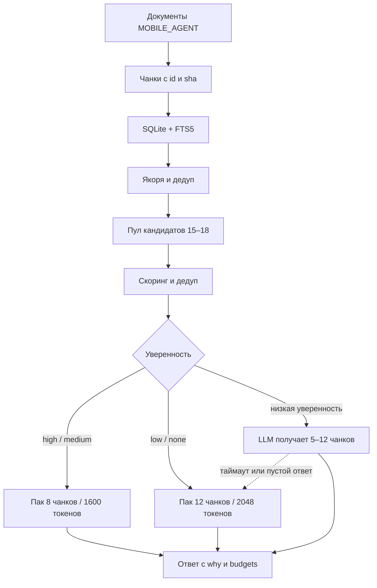

Почему это работает надёжно:

- **Детерминизм.** Один и тот же индекс и запрос дают один и тот же pack.
  Пул FTS зафиксирован, поэтому топ-N — префикс большего N.
- **Порядок источников.** `collectSources()` сортирует по authority
  канонического источника и пути — обход не зависит от файловой системы.
- **Честные источники.** Найдена и устранена дедупликация канонического
  источника: живой индекс иногда оставлял устаревшую копию правила из `docs/`.
- **Никаких тихих потерь.** Удаление заменяется `supersede`, архивом, аудитом
  и откатом. Секреты в индекс не попадают: `secret:0`.
- **Самопроверка.** `memory_bench` считает recall, gate сравнивает его с
  baseline и показывает delta, а не просто «прошло/не прошло».
- **Живая диагностика.** `diag-live-recall.mjs` читает реальную базу приложения
  в режиме только для чтения и показывает конкретные промахи gold.

### Дефект `created` и его корень

Раньше при правке документа индексатор писал `created = now` всем чанкам
изменённого файла, хотя id включает источник, номер строки и sha текста. Чанк
«молодел», живой gold терял g17. Теперь старые `created` сохраняются в карте по
id и подставляются обратно для совпавших чанков. Регресс-тест 2b проверяет
именно этот случай; на apk-52 правка шапки `СОСТОЯНИЕ.md` без подготовки дала
`updated=1`, recall 20/20, gate `pass`.

### Волна 1: факты со временем

`memory_fact` и `memory_fact_link`: у факта есть `topic_key`, `valid_from`,
`invalid_at`, уверенность и причина. Старый факт не удаляется, а закрывается
новым; откат возвращает предыдущее состояние через аудит. Запрос с `as_of`
показывает, что было актуально в нужный момент. Новых MCP-инструментов нет —
режим задаётся параметрами существующих вызовов.

### Нестабильность якорного пула

У частого якоря (`apk`) bm25 почти нулевой, поэтому при равной оценке SQLite
возвращал строки в порядке `rowid`. Инкрементальная правка меняла `rowid`, и
эталон выпадал из пула: живой recall падал до 0.950. Веса ранжирования
оставили нетронутыми и исправили индексатор: колонка `ord` хранит порядок
обхода файлов, обе FTS-таблицы пересобираются целиком. Регресс-тест 4g
намеренно переворачивает строки FTS и требует совпадения с свежим индексом.

---

## Адаптивный слой и закрытое ядро

### Два профиля одного ядра

| | dev/debug | release (рубеж) |
|---|---|---|
| `MCP_DOCS_DIR` | включён, удобно отлаживаться | `""` — документы разработчика не вход в ядро |
| SQLite | общий каталог воркспейса | app-private `filesDir` |
| Память | operator-log + сигналы | только `ingest / signal / approve` пользователя |
| Перенос | клонирование репозитория | export/import-бандл с версией и hash |
| Сборка | apk-76 установлена | следующий рубеж — только после отдельного подтверждения |

**Принцип:** APK несёт **код ядра + стартовый gold**. Ни `СОСТОЯНИЕ.md`, ни
`ЖУРНАЛ.md`, ни `README.md` внутрь APK не попадают — это operator-log в
репозитории, а не память приложения. У нового пользователя движок есть, а
знаний нет: они растут из его собственных решений. Сегодня есть паразитная
зависимость от `<external>/MOBILE_AGENT`, и её надо убрать в релизе. Именно она
объясняет, почему живой `index_sha` apk-76 (`5440945b9becf9db`) совпадает с
локальным: `MCP_DOCS_DIR` пока включён и индексирует оператор-доки воркспейса
(23 файла / 902 чанка после правок 24.11).

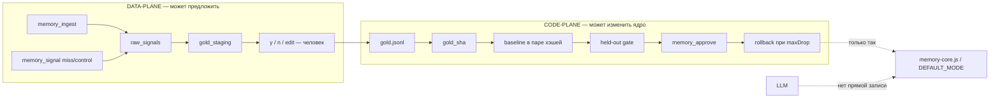

Ограничения data-plane: `deltaCap 0.10`, `cooldownUniqueQueries 20`,
`maxDrop 0.02`, `maxSeen 256`, `maxHistory 32`. Сигналы: `maxCandidates 200`,
`maxControl 40`, TTL 7 дней, `curateThreshold 10`, `batchTarget 15`.
При повреждении файла состояние карантинируется, а не применяется.

### Саморастущий gold-корпус

Сейчас **113 gold-кейсов и 30 held-out**. Сплит записан в каждую строку и
**никогда не пересчитывается**; это закрывает утечку, когда правка порогов
перетаскивала кейс из train в validation. Новые ID получают детерминированный
бакет `sha256-bucket-75-v1` с солью `gold-v1`; старые 40 сохранены без
пересчёта. Канон append-only: существующие метки не правятся даже когда контент
переезжает между документами — такие случаи фиксируются отдельной диагностикой
с подстановкой в памяти.

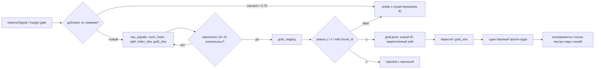

| Правило | Как ложится на стек |
|---|---|
| Сплит навсегда | `split`, `split_policy`, `hash_salt` в строке gold; backfill 40 кейсов без пересчёта |
| Дедуп по смыслу | Jaccard по леммам + `aliasScore` (containment), чтобы не склеить разные намерения |
| Карантин | `raw_signals → gold_staging → y/n/edit → gold.jsonl`; сырой мисклик не отравляет эталон |
| Стратификация | Квота ≤30% на `expect_source` за батч, до 3 control на батч |
| Пара хэшей | `index_sha` (документы) + `gold_sha` (эталон) в каждом протоколе |

Подробности —
[MOBILE_AGENT/РОСТ_ЗОЛОТОГО_КОРПУСА.md](./MOBILE_AGENT/РОСТ_ЗОЛОТОГО_КОРПУСА.md).

---

## Гибрид: что попробовали и от чего ушли

<p align="center">
  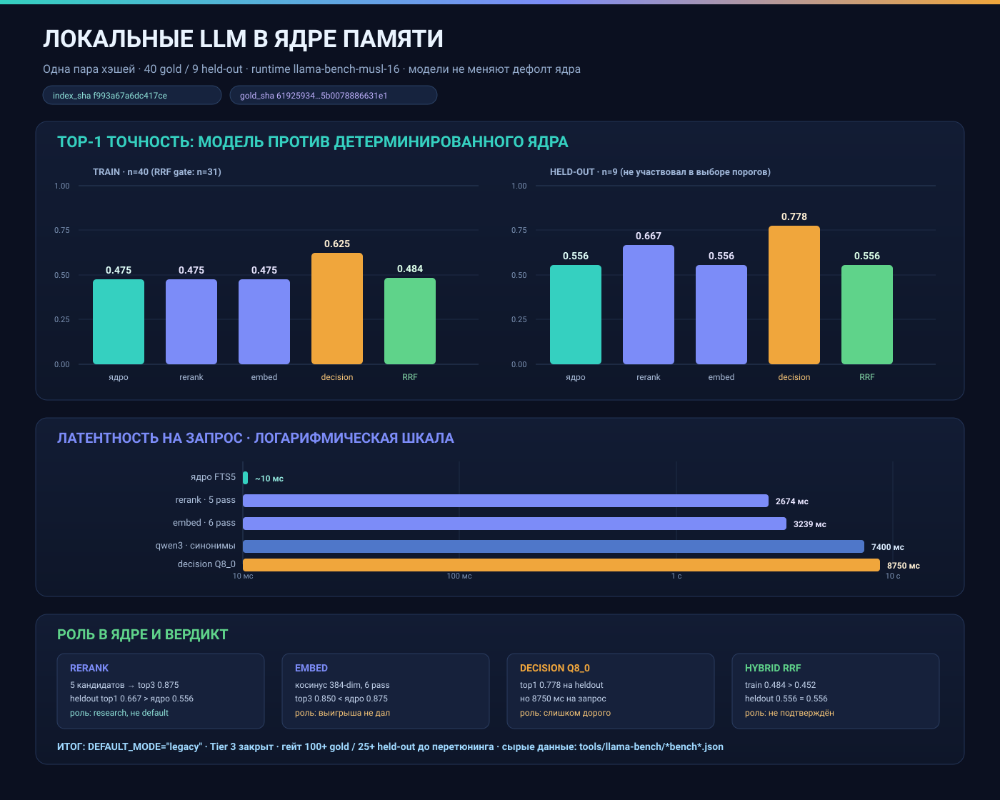
</p>

Три локальные GGUF-модели замерены на одной паре хэшей (`runtime llama-bench-musl-16`):

| Модель | Роль | sha256 (начало) | Результат |
|---|---|---|---|
| `hs-rerank-1` | переранжирование 5 кандидатов | `bea8bca1…` | top3 чуть лучше, top1 равен ядру; ~2674 мс/запрос |
| `hs-embed-1` | косинусный ранжир | `249db62c…` | не дал подтверждённого выигрыша |
| decision Q8_0 | бинарный выбор | `9847b9dc…` | top1 0.625 на train и 0.778 на heldout против 0.475/0.556 у ядра, но 8750 мс на запрос |

`hybrid-gate.mjs` пробовал относительный отрыв `(s0-s1)/(s0+eps)` против родного
`confidenceOf()` и линейную смесь против weighted RRF. Порог и вес выбирались
только на train (31 кейс); held-out (9) не участвовал. На train нашёлся вариант
с чуть лучшим top1, **на held-out гибрид не лучше ядра**. Ровно тот сценарий,
от которого предупреждал Макс, — выигрыш не подтвердился.

**Решение:** `DEFAULT_MODE="legacy"`, Tier 3 не открывать, гибрид и
модельный арбитраж остаются opt-in research. Гейт доказательств: **100+ gold и
25+ независимых held-out** до какого-либо перетюнинга. Гейт пройден: корпус
расширен до **113 gold / 30 независимых held-out** (`РОСТ_ЗОЛОТОГО_КОРПУСА.md`).
Прогон `hs-decide-1-flash` Q8_0 на новом корпусе **опроверг старый выигрыш**:
модель проиграла ядру по top1 и на всех (0.487 против 0.593), и на held-out
(0.667 против 0.733); гейт по неуверенности не дал выигрыша ни на одном признаке.
Дефолт остаётся детерминированный FTS5, модель — research/opt-in. Разбор:
`MOBILE_AGENT/tools/llama-bench/DECISION-GOLD113.md`. Внешние embed/rerank
(e5-small, bge-v2-m3) тоже прогнаны на 113/30 и тоже проиграли ядру по top1
и held-out (0.600 и 0.500 против 0.733); гибрид bge на held-out 0.700. Итоговая
сводка — `MOBILE_AGENT/tools/llama-bench/EXTERNALS-GOLD113.md`. Финальный вердикт
всего research (дефолт FTS5, APK не трогать) — `MOBILE_AGENT/ВЕРДИКТ_RESEARCH_ПАМЯТИ.md`.
Retrieval-фикс: исправлена инверсия bm25, top1 held-out 0.733→0.800 —
`MOBILE_AGENT/tools/llama-bench/RETRIEVAL-FIX-BM25.md`. Волна 1 безопасности
ядра: fail-closed манифест, `approve` как гейт provenance и receipt цитат —
подробности в `MOBILE_AGENT/ВЕРДИКТ_RESEARCH_ПАМЯТИ.md`. Волна 2: детерминированный
FTS5-прирост в дефолтном `legacy` (recall5 0.982, held-out 1.000), held-out gate
по умолчанию и `MCP_OPERATOR_ID` из Kotlin. Волна 3 добавила явный
`mode:"l0"` с entity-алиасами, Волна 4 — opt-in `mode:"wave4"` с одним слотом на
источник в топ-5 (дефолт по-прежнему `legacy`). **Активная сборка apk-76**
(opencode 2.4.0, versionCode 76), все четыре волны доставлены на телефон и
подтверждены живой сверкой ассетов, `/api/info` и `wave4`-поиска. После установки
прогнан полный живой замер (358 MCP-вызовов) и диагностика: два «провала»
gold оказались устаревшими метками, а не дефектом поиска; с исправленными
метками поиск закрывает 100% корпуса. Подробности — раздел ниже и
`MOBILE_AGENT/ВОЛНА_3_ENTITY_L0.md`.

---

## Резидентный LLM-сопроцессор

Модель `qwen3-0.6b-q4km` скачивается отдельно, сверяется по размеру и sha256 и
кладётся в `files/musl/` рядом с `.so`. Внутри APK внешних npm, Python, Go или
Rust-зависимостей нет: только `bun:sqlite`, локальные модули и песочница.

| Режим | Когда вызывается | Что происходит |
|---|---|---|
| `core-only` | Высокая или средняя уверенность ядра | LLM не вызывается, ответ за ~10 мс |
| `force` | Кнопка в диагностике | LLM вызывается принудительно, pack ядра внутри |
| Авто | Низкая уверенность | LLM вызывается сама, при отказе — молчаливый fallback |

Замер честно показал, что LLM как селектор слабее ядра и намного медленнее:

| Путь | recall | Латентность |
|---|---:|---:|
| Ядро | 1.000 | 5–20 мс |
| Ядро + синонимы LLM | 1.000 | около 7.4 с |
| LLM как селектор | 0.250 | около 7.4 с |
| 6 парафраз: ядро | 1.000 | — |
| 6 парафраз: селектор | 0.167 | — |

Поэтому LLM остаётся источником синонимов и evidence, а не судьёй.

---

## Жёсткий gold и метрики

**Замороженный эталон:** `gold_sha = b4421d088404551bd9506a83eb69e8c1be877a0b63a9169c6dd816d0803255f5`,
`gold_n = 113`, `heldout_n = 30`. `index_sha` в витрине не фиксируется
намеренно: индекс строится из рабочих доков `MOBILE_AGENT/` и сдвигается при
каждой правке ЖУРНАЛА или СОСТОЯНИЯ, поэтому каждая запись в памяти хранит
свою пару `index_sha|gold_sha`.

Последний локальный замер дефолтного `legacy`: recall@5 **0.9823**, MRR
**0.8940**, nDCG **0.9162**; held-out **1.000 / 0.9361 / 0.9521**. Живой MCP
на apk-76 живой индекс собран из тех же рабочих доков (`index_sha
5440945b9becf9db`, 23 источника / 902 чанка), поэтому локальный и живой замеры
совпадают. Режим `mode:"l0"` поднимает локальный MRR до 0.8988 и закрывает
парафразы h04/h14, не меняя held-out. Волна 4（`mode:"wave4"` = l0 + один слот
на источник в топ-5) дополнительно закрывает h06: hard recall@5 **1.000**,
MRR gold 0.9041, held-out 0.9444. Вживую h06 в топ-5 попадает только в `wave4`.

Все гипотезы сравниваются **только внутри одной пары** `index_sha|gold_sha`.
Смена любого хэша означает новый базовый прогон ядра; старые протоколы
остаются в `tools/llama-bench/*bench*.json` как история.

| Этап | recall@5 | recall@12 | pack | adaptive | Промахи |
|---|---:|---:|---:|---:|---|
| До починки пула | 0.95 | 0.90 | 0.90 | 0.90 | h10 |
| После починки пула | 0.95 | 1.000 | 1.000 | 1.000 | — |
| После apk-49 | 1.000 | 1.000 | 1.000 | 1.000 | — |
| После apk-52 вживую | 1.000 | 1.000 | 1.000 | 1.000 | — |
| Текущая пара (23 источника) | 0.950 | — | — | — | — |

Свежий прогон жёсткого gold: `n=20`, `avgMs=8`, `avgAdaptiveMs=5`,
`avgTokens=1713`, `misses=[]`.
Отчёт —
[архивы/БЕНЧМАРК_СЛОЖНЫХ_ЗАПРОСОВ.md](./MOBILE_AGENT/архивы/БЕНЧМАРК_СЛОЖНЫХ_ЗАПРОСОВ.md).

### График recall по сборкам

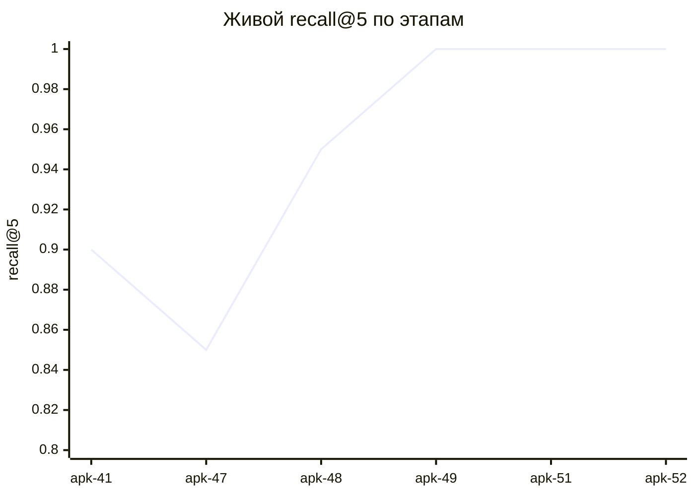

Провал на apk-47 честный: gate был перебазирован с 0.90 на 0.85 с согласия
Макса, старые строки ушли в архив с аудитом. Дальше пул якорей расширили до 18
и вернулись к 1.000.

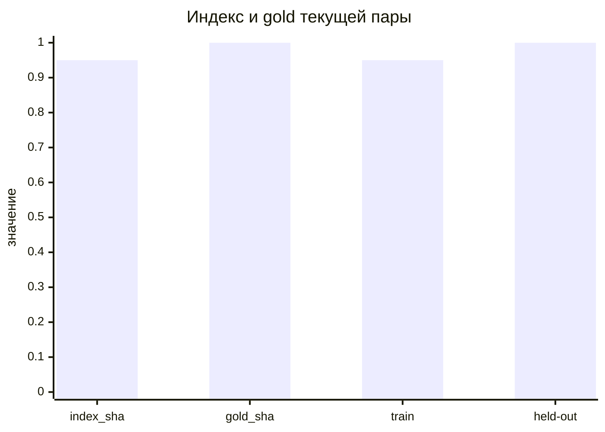

### Честность меток: g03/g13 и дефект nDCG (24.11)

Диагностика провалов показала: `g03` и `g13` — не дефект поиска, а
**устаревшие метки gold**. Канон `gold.jsonl` не правили (методика
append-only: менять метки = двигать ворота и ломать базовые ключи). Метрики
пересчитаны с временной подстановкой в памяти (`tmp/gold-honest-metrics.mjs`):

| Набор | Режим | RAW r5 / MRR / nDCG | С исправленными метками |
|---|---|---|---|
| gold 113 | legacy | 0.9823 / 0.8940 / 0.9162 (miss g03,g13) | **1.000 / 0.9058 / 0.9295** |
| gold 113 | l0 | 0.9823 / 0.8988 / 0.9199 (miss g03,g13) | 0.9912 / 0.9032 / 0.9254 (g13) |
| gold 113 | wave4 | 0.9823 / 0.9041 / 0.9242 (miss g03,g13) | **1.000 / 0.9115 / 0.9342** |
| held-out 30 | legacy / l0 | 1.000 / 0.9361 / 0.9521 | без изменений |
| held-out 30 | wave4 | 1.000 / 0.9444 / 0.9587 | без изменений |
| hard 20 | legacy / l0 / wave4 | 0.850 / 0.950 / **1.000** | h06 закрыт только в wave4 |

Пара замера: `index_sha 5dbe582230c37547` / `gold_sha b4421d08…255f5`. На этом
индексе l0 потерял g13, wave4 его вернул — ещё одно свидетельство, что
диверсификация головы укрепляет поиск против дрейфа доков.

`g03` → `ЖУРНАЛ.md` (`apk-40` и `verify-install` в ХАРНЕС разнесены по чанкам),
`g13` → `КАТАЛОГ_ПЕРЕДЕЛОК.md` (в АРХИТЕКТУРЕ нет точной фразы
`blocked_on_external_grant`), `g05` метка верная. При метках под текущий
контент поиск закрывает **100% gold**, а направление legacy→l0 по MRR то же.

Одновременно исправлен дефект бенч-скриптов: у кейсов с `expect_any` ранг
брался только по `expect_source`, что при `at=-1` давало деление на `log2(1)=0`
и `ndcg=Infinity`. Теперь ранг берётся по любому совпавшему источнику.

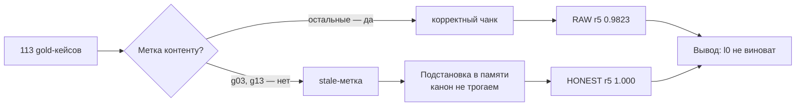

### Волна 4 (локально): диверсификация топ-5

Гейт нашёлся на `gold-hard`: h06 («вес якорей и графа») — нужное правило в
индексе, но на ранге 7, а первые четыре места занимал `СОСТОЯНИЕ.md`. Новый
opt-in `mode:"wave4"` даёт каждому источнику один слот в топ-5, **не меняя
score** (дубли уходят в хвост). Дефолт `legacy` и `l0` не тронуты.

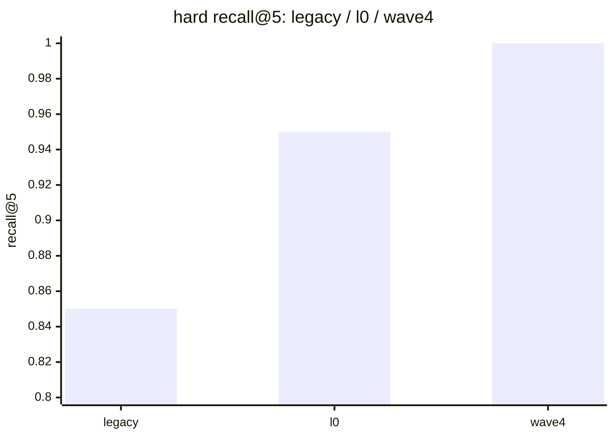

Отчёт — [ВОЛНА_4_ТОП5_ДИВЕРСИФИКАЦИЯ.md](./MOBILE_AGENT/ВОЛНА_4_ТОП5_ДИВЕРСИФИКАЦИЯ.md).
Доставлено в apk-74: release run #70, versionCode 74, `verify-install.sh` →
`match=yes`, живой h06 закрыт только в `wave4`.

---

## Тесты и проверки

Полный раннер — `MOBILE_AGENT/opencode/run-core-tests.sh`:

| Набор | Проверок | Статус |
|---|---:|---|
| Ядро `memory-core.test.mjs` | 345/345 | зелёный |
| Adaptive `memory-adaptive-store.test.mjs` | 38/38 | зелёный |
| Gold corpus `gold-corpus.test.mjs` | 39/39 | зелёный |
| Интеграция `memory-integration.test.mjs` | 140/140 | зелёный |
| GGUF-гейт `gguf-integration.test.mjs` | 109/109 | зелёный |
| Замки источников `check-sources.mjs` | 23/23, расхождений 0 | зелёный |
| CJK-guard в исходниках ядра | чисто | зелёный |
| Контракт импорт ⇒ экспорт ассетов | 61 импорт / 0 проблем | зелёный |
| Полный CI (Debug APK + Native build) | success | зелёный |

Rerun после apk-74, честного замера и Волны 4: **все тесты прошли**,
`ИТОГ: ядро памяти — ВСЕ ТЕСТЫ ПРОШЛИ`.

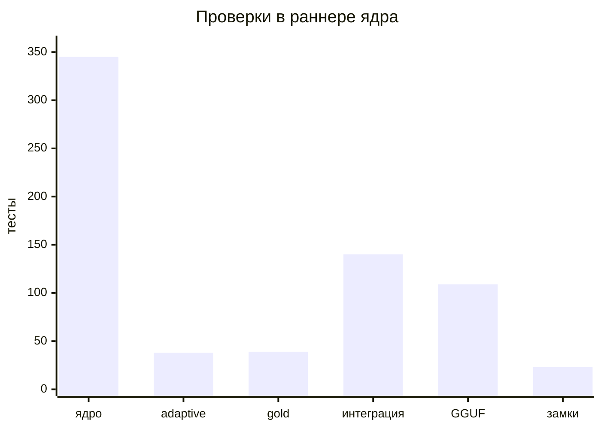

Отдельная защита от повторения брака apk-63: JVM-тест
`McpAssetImportContractTest.kt` проверяет, что **каждый именованный импорт имеет
экспорт в целевом модуле**. На ассетах apk-63 он нашёл ровно одну проблему
(`goldSha`), на `main` после починки — ноль. Staged-ассеты байтно равны
протестированному ядру до запуска Release.

CI в витрине намеренно не привязан к номеру run: конкретные ID быстро
устаревают, а формулировка «CI зелёный» остаётся верной после правки доков.

### Уборка рабочего каталога

| Параметр | До | После |
|---|---:|---:|
| Записей в `tmp/` | 238 | 25 |
| Занято | около 1.03 ГБ | 15 МБ |
| Удалено по списку | — | 213 путей |
| Архив | — | 17 511 545 байт |

Подробности —
[архивы/МАНИФЕСТ_УБОРКИ_TMP_20261120.md](./MOBILE_AGENT/архивы/МАНИФЕСТ_УБОРКИ_TMP_20261120.md).

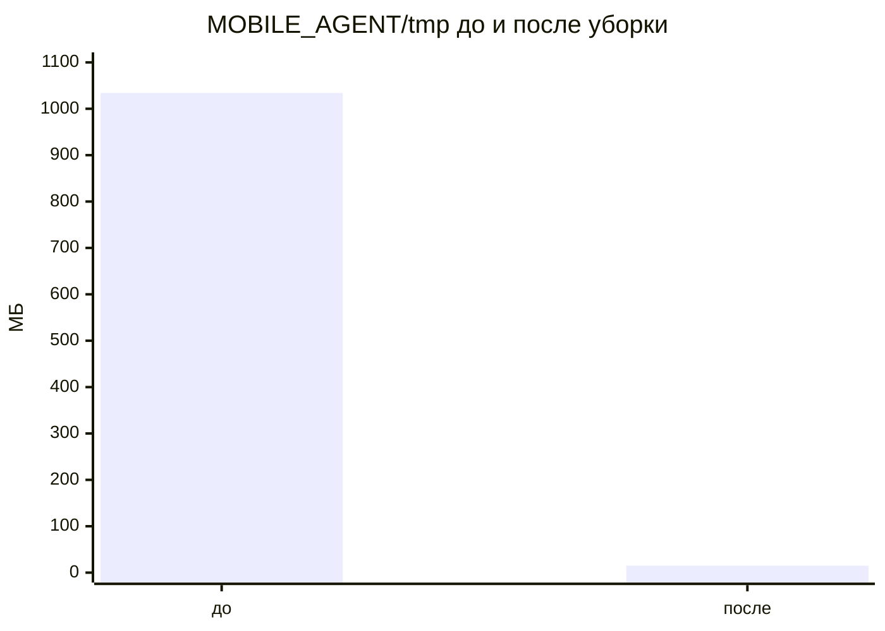

---

## Moltbook: живой контур агента

Плагин :4201 работает под sha-замком (`03dcdc06…` совпал перед каждым
сетевым вызовом). Тик сканирует ленту, отвечает кандидатам по одному, решает
challenge самостоятельно и пишет `MOLTBOOK_REPORT.md`.

| Исход ответа | Что это значит |
|---|---|
| `verified` | challenge решён, перечитка треды подтвердила коммент |
| `reused` | ветка уже закрыта нашим прежним ответом — повторно не шлём |
| `deferred` | родитель ниже капа глубины, отвечаем на верхнем уровне треда |
| `unconfirmed` | сервер сказал `200/ok`, но перечитка не видела — успехом не считаем |
| `verification-failed` | неверный ответ challenge: коммент удаляется, повторной попытки нет |

Правило арифметики challenge: явный `*` / `times` / `product` → умножение,
`and`/`total` без `*` → сложение. last tick: `verified 8`, `failed 1`,
`deferred 1`, `pending 242`, `refusals 15`, `external_blocks 0`.
Сторож тика отдельно: тревога «молчит 3 ч» оказалась рассинхроном расписания
после переустановки apk-65, а не падением плагина.

Отчёт — [MOBILE_AGENT/MOLTBOOK_REPORT.md](./MOBILE_AGENT/MOLTBOOK_REPORT.md).

---

## Версия opencode и самообновление

Начиная с apk-69 APK вшивает **opencode 2.4.0** (байтно равен npm-пакету
`@opencode/cli-linux-arm64-musl@2.4.0`), поэтому при чистой установке не
приедет старый 2.3.0. Приложение и дальше спрашивает реестр npm (тег
`latest`), сверяет sha512 из `dist.integrity`, прогоняет `--version` и только
потом кладёт обновлённый бинарь в приватное хранилище. Старт идёт из
`nativeLibraryDir` через `libldmusl.so`. Проверка не чаще раза в
6 часов и только по Wi-Fi. Два падения подряд — откат на ядро из APK, версия
запоминается как отбракованная. Мажорные версии автоматически не ставятся.

Источник истины о версии — живой `GET /api/info`, а не документация:
`/global/health` на 2.x отвечает заглушкой SPA на неизвестные пути. Все семь
этапов перехода 1.x → 2.x описаны в
[docs/MIGRATION-V2.md](./docs/MIGRATION-V2.md).

---

## Документация

- [Возможности](./docs/features.md) — чат, мобильный агент, локальная память, самодиагностика, голосовой ввод, настройки.
- [Техническое устройство](./docs/architecture.md) — запуск opencode на Android без root, локальная память MCP и Basic Auth, STT и foreground-сервис.
- [Сборка и установка](./docs/build-and-install.md) — GitHub Actions, локальный вариант, бинари, установка APK и проверка релиза.
- [Структура проекта](./docs/project-structure.md) — модули, исходники и служебные каталоги.
- [История и ограничения](./docs/history-and-limitations.md) — оптимизации, планы и известные тонкости.
- [Правила мобильного агента](./MOBILE_AGENT/ПРАВИЛА.md) — как агент работает с памятью, проверками и удалением.
- [Харнес](./MOBILE_AGENT/ХАРНЕС.md) — каталог инструментов с точными путями.
- [Состояние](./MOBILE_AGENT/СОСТОЯНИЕ.md) — текущий рубеж и активная память агента.
- [Журнал](./MOBILE_AGENT/ЖУРНАЛ.md) — хронология apk-12…73, CI и живые приёмки.
- [Рост золотого корпуса](./MOBILE_AGENT/РОСТ_ЗОЛОТОГО_КОРПУСА.md) — сплиты, дедуп, карантин, квоты, пара хэшей.
- [Moltbook-отчёт](./MOBILE_AGENT/MOLTBOOK_REPORT.md) — итоги последнего тика.
- [Разбор CI и фикса `created`](./MOBILE_AGENT/архивы/ИСПРАВЛЕНИЕ_CI.md) — detekt, ktlint, JVM-тесты и корневой фикс индексатора.

---

## Итог

Проект прошёл путь от «android-обёртка над opencode» до самостоятельного
мобильного агента с детерминированной памятью, опциональным LLM-сопроцессором
и живым контуром самообучения. Текущая сборка **apk-76** установлена, данные
приложения сохранены, полный CI зелёный, все тесты зелёные. Ядро держит дефолт
`legacy`, experiments изолированы в data-plane, гибрид не пущен в продакшн,
потому что held-out не подтвердил выигрыш. Диагностика 24.11 показала, что
дефицит gold объясняется устаревшими метками, а не поиском: с метками под
текущий контент корпус закрывается на 100%. Волна 4 доставила opt-in
`mode:"wave4"` (диверсификация топ-5) в apk-74: hard r5 1.000, h06 закрыт
вживую. У нового пользователя память будет
расти из его собственных ingest/сигналов/апрувов, а не из чужого operator-log —
этот архитектурный рубеж следующий, под отдельное подтверждение.
